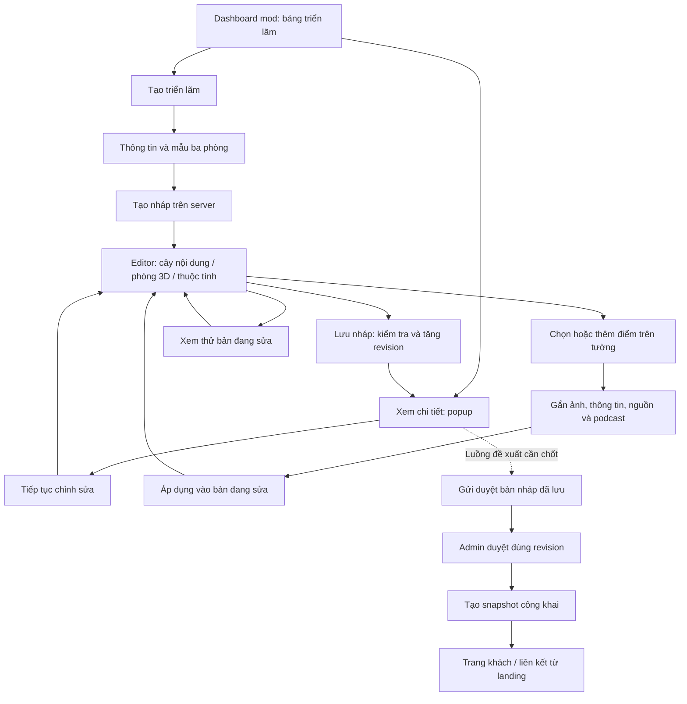

# Kế hoạch triển khai trình tạo triển lãm 3D — Sử Ký

> Hướng dẫn cho agent thực hiện: đọc tài liệu này và quy định AGENTS.md của từng ứng dụng. Dùng workflow `superpowers:executing-plans` để triển khai từng task. Checklist bên dưới dùng để theo dõi tiến độ, chưa có task nào được thực hiện.

**Mục tiêu:** Mod quản lý triển lãm qua dashboard table hiện có, sau đó tạo/chỉnh sửa bằng trình biên tập trực quan theo ba mockup.

**Kiến trúc:** Tái sử dụng cảnh Three.js hiện tại, tách dữ liệu triển lãm khỏi renderer, bổ sung editor và API lưu nháp. Renderer dùng chung cho editor, xem thử và trang khách; bản công khai độc lập với thay đổi trong nháp.

**Stack:** React 19, React Router 7, Tailwind v4, shadcn/ui, TanStack Query, React Three Fiber, Three.js; Bun, Hono, Zod, Prisma và PostgreSQL theo repository.

**Đặc tả tham chiếu:** yêu cầu đã thống nhất trong hội thoại và ba mockup cùng thư mục: [01 — Tạo triển lãm](01-tao-trien-lam.png), [02 — Biên tập trong phòng](02-bien-tap-trong-phong.png), [03 — Xem thử podcast](03-xem-thu-podcast.png).

**Trạng thái:** Kế hoạch đề xuất ngày 28/10/2026. Người dùng đã chọn hướng giao diện; các quy tắc xuất bản bên dưới là đề xuất cần chốt trước khi triển khai phần xuất bản. Tài liệu không xác nhận các API mới đã tồn tại.

## 1. Các ràng buộc chung

- Trang chính của mod dùng dashboard table, không dùng giao diện editor làm trang danh sách.
- Ba mockup là chuẩn cho luồng tạo/chỉnh sửa/xem thử; thiết kế không gian và chi tiết của mockup 03 cũng áp dụng cho triển lãm đầu ra trên trang khách. Trang quản lý vẫn dùng dashboard table.
- **Yêu cầu đầu ra bắt buộc:** giao diện thực tế của trình tạo, editor và triển lãm 3D sau khi tạo phải tái hiện sát thiết kế trong ba mockup. Mockup là chuẩn nghiệm thu thị giác, không chỉ là hình tham khảo ý tưởng. Hoàn thành chức năng/API nhưng giao diện khác thiết kế chưa được coi là hoàn tất.
- Tái sử dụng component bảng, phân trang, badge, toast và xác nhận của dashboard; không tạo bản sao riêng cho triển lãm.
- Nút chữ “Xem chi tiết” mở trang trực tiếp. Không thay bằng icon mắt hoặc menu ba chấm.
- Dùng token `mod-*` cho dashboard/editor, token triển lãm cho trải nghiệm khách. Đối chiếu font và token runtime trong `globals.css`; không suy ra font từ hình sinh.
- Bản đầu tạo giao diện không gian chuẩn như trong mockup, tự căn hướng ảnh theo tường và giữ cao độ treo chuẩn.
- Không thêm thư viện 3D/editor mới khi React Three Fiber và Three.js đã đáp ứng.
- Type/schema dùng chung đặt trong `packages/shared`; API gọi qua Hono RPC và TanStack Query. Lỗi có dạng `{ error_code, message }`.
- Không lấy ảnh AI trong mockup làm ảnh tư liệu thật. Dùng ảnh gốc/tài sản được cung cấp trong project và lưu thông tin nguồn tương ứng.

## 2. Hiện trạng đã đối chiếu code

| Vị trí | Hiện trạng | Hướng xử lý |
|---|---|---|
| `src/features/exhibition/data.ts` | 12 ảnh, ba chương, walls, floorAreas, spawn và bảng màu tĩnh; Artwork chưa có podcast | Tách template hình học khỏi nội dung; đưa nội dung vào cấu hình API |
| `src/features/exhibition/ExhibitionExperience.tsx` | Trạng thái intro/walking/paused/menu/artwork; MP3 nền cục bộ | Nhận cấu hình, giữ luồng khách, bổ sung phối hợp audio |
| `GalleryScene.tsx` | Import trực tiếp artworks | Nhận dữ liệu qua props, dùng chung cho ba chế độ |
| `GalleryArchitecture.tsx` | Nhãn chương viết trực tiếp trong JSX | Nhận tiêu đề/mô tả chương qua dữ liệu |
| `GalleryControls.tsx` | Có raycast, artworkId, pointer lock và WASD | Giữ điều khiển đi bộ; editor có điều khiển chọn/kéo riêng |
| `artworkLayout.ts` | Tâm ảnh theo `EYE_LINE = 1.75`; width đầu vào còn được fit lại | UI phải dùng kích thước thực sau fit; không hiển thị position.y như giá trị có thể sửa tự do |
| `ExhibitionDialogs.tsx` | Có nguồn ảnh, quyền sử dụng và nội dung | Bổ sung podcast liên quan, không bỏ các trường hiện có |
| `moderator/navItems.ts`, `paths.ts`, `types.ts` | Chưa có section triển lãm | Thêm section, đường dẫn và menu |
| `ModeratorWorkspacePage.tsx` | Chọn màn từ pathname; không render Outlet | Bổ sung nhánh exhibitions và phân biệt list/new/editor/preview tại container feature |
| `app/router.tsx` | Route khách hiện tại `/trien-lam-1975` | Giữ tương thích; thêm route triển lãm động |
| `libraryService.ts`, `PodcastPlayer.tsx` | Có API series/episode/narration, audio và tiến độ nghe | Tái sử dụng nghiệp vụ playback, không lưu audio URL vào cấu hình triển lãm |
| API `modules/listening/presentation/listening.routes.ts` | Playback yêu cầu đăng nhập bằng `requireAuth` | Khách chưa đăng nhập nhìn thấy lời mời đăng nhập, không được dùng quyền mod để phát thay |
| API `modules/media/presentation/media.routes.ts` | Có image-policy, tạo asset, verify | Tái sử dụng upload hiện có; chỉ nhận asset ảnh hợp lệ |
| `packages/db/prisma/schema.prisma` | Có Series/Episode/EpisodeNarration; chưa có thực thể triển lãm | Thêm dữ liệu triển lãm và bản công khai |

Đường dẫn `src/...` trong bảng trên tính từ `apps/web/`.

## 3. Flow tổng thể

### 3.1. Dashboard table — trang chính

- URL đề xuất `/moderator/exhibitions`.
- Header “Triển lãm 3D”, mô tả ngắn và nút “Tạo triển lãm”.
- Toolbar: tìm tên, lọc trạng thái, phân trang server; tìm kiếm reset về trang 1. Giai đoạn chỉ có nháp thì chỉ hiển thị trạng thái thực sự hỗ trợ.
- Cột: Tên triển lãm, Số chương, Điểm trưng bày, Podcast đã gắn, Trạng thái, Cập nhật lần cuối, Thao tác.
- Dùng `DashboardTableCard`, `DashboardDataTable`, `DashboardPagination`, `CardBadge`, `ModeratorListToolbar` và `DashboardRowActions` theo API thực tế của component.
- Mỗi hàng giữ một nút “Xem chi tiết”. Popup chứa thông tin tổng quan, “Tiếp tục chỉnh sửa”, “Xem thử bản đã lưu” và các hành động trạng thái được server cho phép.
- Không hiển thị nút xóa/công khai/gửi duyệt nếu nghiệp vụ chưa triển khai. Không lặp các hành động của popup lên hàng bảng.
- Loading, error có thử lại, empty và success phải riêng biệt. Empty có nút tạo đầu tiên. Không biến lỗi API thành bảng rỗng.

### 3.2. Tạo triển lãm — mockup 01

1. Mở `/moderator/exhibitions/new` từ nút tạo.
2. Nhập tên, phụ đề, giới thiệu; chọn mẫu `gallery-1975-v1` gồm ba phòng hiện tại.
3. Sửa tên, thời kỳ, mô tả ba chương tương ứng ba phòng. Giữ roomKey ổn định khi đổi tên.
4. 12 vị trí hiện có là gợi ý, không bắt buộc có đủ 12 ảnh. Triển lãm mới khởi tạo trống nội dung; không tự sao chép toàn bộ tư liệu năm 1975 vào mọi chủ đề.
5. “Vào bố trí không gian” kiểm tra các trường bắt buộc, tạo nháp rồi chuyển tới `/moderator/exhibitions/:id/edit`. Chặn bấm lặp bằng trạng thái pending và Idempotency-Key.
6. Tên triển lãm không rỗng, tối đa 255 ký tự; phụ đề tối đa 255; giới thiệu tối đa 2.000. Có thể lưu nháp chưa có ảnh/podcast.

**Hiệu chỉnh mockup:** bỏ “Thêm chương” và nút xóa chương ở bản đầu vì hình học cố định ba phòng. Thanh bước điều hướng được, không tạo ba bản dữ liệu độc lập.

### 3.3. Bố trí trong phòng — mockup 02

| Khu vực | Nội dung và thao tác |
|---|---|
| Thanh đầu | Quay về danh sách, tên triển lãm, trạng thái lưu, “Xem thử”, “Lưu nháp” |
| Trái | Cây ba chương và điểm trưng bày, chọn điểm để focus camera; “Thêm điểm trưng bày” |
| Giữa | Cảnh 3D, viền đỏ điểm đang chọn, placeholder trên tường, Bố trí/Đi thử và Hoàn tác |
| Phải | Inspector: ảnh/poster, tiêu đề, mô tả, ngày hiển thị, credit, URL nguồn, quyền sử dụng, podcast; tab Nội dung/Vị trí |

**Thêm điểm:** chọn chương → chọn tường/vị trí gợi ý → chọn ảnh → nhập nội dung → gắn podcast nếu cần → “Áp dụng”. Có thể chọn một điểm từ cây thay cho click 3D.

**Chọn và kéo:** raycast lấy wallId; tính khoảng cách `offset` dọc đoạn tường từ đầu a; tự lấy hướng mặt trong của tường. Kéo ảnh chỉ đổi offset trên cùng mặt tường. Đổi sang tường khác là thao tác chọn tường đích riêng. Không cho sửa x/y/z hoặc xoay tự do.

**Ràng buộc:** bounding box ảnh và caption phải nằm trong vùng treo hợp lệ, tránh lối đi và không chồng điểm khác. Dùng vùng treo định nghĩa bởi template; không chỉ dựa vào độ dài walls vì có các góc, nhãn chương và cửa. Cao độ ảnh dùng EYE_LINE hiện có. Kích thước UI phản ánh width thực sau `artworkLayout`, không dùng nhầm giá trị width cấu hình trước fit.

**Bố trí:** con trỏ tự do; click chọn, kéo điểm để di chuyển; kéo nền cảnh khi không trúng điểm để nhìn quanh. Khi kéo điểm thì khóa xoay camera. Không chiếm pointer lock.

**Đi thử:** bật WASD/chuột/pointer lock như hiện tại; vô hiệu hóa kéo ảnh. Esc nhả pointer lock, xóa phím đang giữ và trở về Bố trí, giữ camera hiện tại. Nhập text/mở popup không được làm nhân vật di chuyển.

**Inspector:** “Áp dụng” chỉ cập nhật document trong bộ nhớ và đánh dấu chưa lưu; đóng với thay đổi chưa áp dụng phải cho giữ hoặc bỏ. “Lưu nháp” mới gọi API. Giữ một document nguồn duy nhất; preview không tạo bản sao có thể sửa riêng.

**Hoàn tác:** ghi một thao tác sau khi kết thúc kéo hoặc Áp dụng; không ghi mỗi frame. Undo chỉ tác động bản đang sửa, vẫn cần lưu lên server.

**Podcast:** popup tìm kiếm tập đã phát hành, lọc theo series; chọn một narration cụ thể. Tối đa một narration mỗi điểm ở bản đầu; một narration có thể xuất hiện ở nhiều điểm. Điểm chỉ nghe podcast vẫn cần poster làm bề mặt trưng bày. Không upload MP3 mới để né hệ thống podcast.

### 3.4. Xem thử — mockup 03

- `/moderator/exhibitions/:id/preview` giữ thanh “Quay lại biên tập” và “Kết thúc xem thử”, ẩn cây/inspector và viền chọn.
- Đi từ editor thì xem document đã Áp dụng, kể cả chưa lưu; có nhãn “Có thay đổi chưa lưu”. Đi từ bảng hoặc refresh thì tải bản đã lưu. Phần sửa chưa Áp dụng trong inspector phải được xử lý trước khi chuyển.
- Dùng cùng renderer và chi tiết ảnh của khách. Popup ảnh có podcast liên quan, chọn narration đã gắn, không thêm trình sản xuất podcast ở đây.
- Bản đầu không tạo endpoint preview playback có quyền cao hơn. Khách thật chưa đăng nhập phải đăng nhập để nghe; preview cần nói rõ đang nghe bằng tài khoản hiện tại, không gọi đó là giả lập khách ẩn danh hoàn toàn.
- Khi phát podcast: dừng nhạc nền. Đóng chi tiết/đổi điểm: dừng podcast. Thoát trang/ẩn tab: dừng audio; khi trở lại không tự phát nếu chưa có hành động người dùng. Tôn trọng chặn autoplay của trình duyệt.
- Khi không có WebGL: vẫn mở được mục lục, chi tiết và podcast theo quyền. Trong editor chuyển về sửa nội dung theo danh sách; báo rõ không bố trí bằng 3D trên thiết bị này.

### 3.5. Lưu và rời trang

- Bản đầu dùng lưu thủ công, không hiển thị tự lưu giả. Trạng thái: Đã lưu / Có thay đổi chưa lưu / Đang lưu / Lưu thất bại.
- Lưu thất bại giữ nguyên document; retry không tạo thêm triển lãm. Thành công nhận revision mới từ server rồi mới hiện “Đã lưu”.
- Server nhận `baseRevision`; lệch revision trả 409. Client giữ bản đang sửa, cho tải bản mới sau khi xác nhận; không ghi đè tự động.
- Chặn điều hướng nội bộ bằng dialog dùng chung khi có dữ liệu chưa lưu. Dùng beforeunload cho đóng tab; không coi đây là cơ chế lưu dữ liệu.

## 4. Thiết kế dữ liệu và hợp đồng renderer

### 4.1. Lựa chọn lưu trữ đề xuất

Để tránh CRUD riêng cho từng cú kéo, lưu cả document bằng một lần PUT trong transaction. Bản đầu dùng:

- `Exhibition`: id UUID, ownerId theo kiểu ID user hiện tại, slug unique, draftRevision integer, draftDocument JSONB, publishedDocument JSONB nullable, publishedRevision nullable, publicationStatus, updatedAt, publishedAt nullable.
- Các trường phục vụ tìm kiếm/bảng như title và số lượng được server suy ra từ draftDocument trong cùng transaction; không tin số đếm client gửi.
- Document chứa schemaVersion, templateId, templateVersion, metadata, chapters và items. Dùng Zod parse cả khi ghi lẫn đọc JSONB. Tham chiếu asset/narration trong JSON phải được service kiểm tra tồn tại và quyền vì không có foreign key cho từng phần tử JSON.
- Không cần bảng revision history hoặc cộng tác realtime ở bản đầu. publishedDocument là snapshot độc lập, đủ để sửa nháp không làm thay đổi trang khách.
- `publicationStatus` và các cột review chỉ bổ sung khi chọn chính sách xuất bản ở mục 7; không dùng enum ContentStatus của podcast nếu luồng khác nhau.

### 4.2. Document dùng chung

`ExhibitionDocument` có:

| Trường | Quy tắc |
|---|---|
| schemaVersion | `1` |
| templateId / templateVersion | `gallery-1975-v1` / `1`; server chỉ chấp nhận mẫu đã biết |
| metadata | title, subtitle, description; coverAssetId nullable |
| chapters | Đúng ba chapter; id UUID, roomKey, title, period, description; roomKey thuộc template, không trùng |
| items | id UUID ổn định; chapterId; imageAssetId; title; description; displayDate; credit; sourceUrl; rights; narrationId nullable; placement |
| placement | wallId, offset mét từ đầu a, width là giá trị cấu hình tương thích artworkLayout hiện tại; chiều cao/góc quay suy ra từ template |

Ngày hiển thị là chuỗi vì hiện có cả “Tháng 4/1975” và “Năm 1975”, không ép mọi giá trị thành ISO date. sourceUrl chỉ nhận HTTP/HTTPS hoặc rỗng ở nháp. Mô tả, credit và quyền sử dụng render dưới dạng text, không HTML tùy ý. ID chapter/item không trùng; item phải thuộc chapter tồn tại và wall hợp lệ của room đó.

Template bao gồm stable wallId, hướng mặt trong, vùng treo hợp lệ, roomKey, chương mặc định, floorAreas và spawn. Hình học dùng chung FE/BE đặt trong `packages/shared/src/exhibition-template.ts`, không import Three.js/React vào shared. Nội dung 1975 cũ nằm riêng ở fixture của web.

Renderer nhận `ResolvedExhibition`: metadata, chapters, items đã được resolve asset URL + kích thước ảnh, placement đã kiểm tra và metadata podcast an toàn. Không trả URL audio trong document; chỉ lấy URL qua playback hiện tại khi người dùng nhấn nghe.

## 5. API đề xuất

Tất cả endpoint triển lãm trong mục này là **mới**. API `/api/studio/*` yêu cầu đăng nhập và role phù hợp; mod chỉ đọc/sửa triển lãm của mình. Admin có quyền xem phục vụ duyệt khi luồng đó được chọn, không mặc định có quyền sửa nội dung của mod.

### 5.1. API bản đầu: danh sách, nháp, nội dung

| Method | Endpoint | Request | Response / hành vi |
|---|---|---|---|
| GET | `/api/studio/exhibition-templates` | Không | `{ items: ExhibitionTemplate[] }`; mẫu đã biết và quy tắc vùng treo |
| GET | `/api/studio/exhibitions` | q, status, page mặc định 1, limit mặc định 10/max 50 | Dùng đúng paginated schema hiện có; summary gồm id, title, counts, trạng thái thực, revision, updatedAt |
| POST | `/api/studio/exhibitions` | `{ document: ExhibitionDocument }`; Idempotency-Key | 201: `ExhibitionWorkspace`; Location tới resource mới, revision ban đầu 1 |
| GET | `/api/studio/exhibitions/:id` | UUID | 200: `ExhibitionWorkspace`, document nháp và dữ liệu resolve để dựng cảnh |
| PUT | `/api/studio/exhibitions/:id/draft` | `{ baseRevision, document }` | 200: workspace mới; transaction compare-and-swap rồi tăng revision |
| GET | `/api/studio/exhibition-podcast-options` | q, seriesId tùy chọn, page/limit | Paginated lựa chọn tập đã phát hành và narration khả dụng; dữ liệu tối thiểu cho picker |
| GET | `/api/exhibitions/:slug` | slug | Chỉ trả snapshot công khai, resolve ảnh và trạng thái podcast hiện tại; không lộ owner hay bản nháp |

`ExhibitionWorkspace = { id, slug, revision, updatedAt, publicationStatus, publishedRevision, document, resolved, allowedActions }`. allowedActions chỉ giúp render UI; service vẫn kiểm tra quyền ở mỗi request. `resolved` được server tạo, không nhận từ payload ghi.

API public chỉ hoạt động sau khi có cơ chế công khai được duyệt; trong giai đoạn nháp trả 404. Không thêm API xóa, sao chép hoặc bulk update khi chưa có nhu cầu được chốt.

### 5.2. Ví dụ lưu nháp

PUT gửi `{ baseRevision: 4, document: <document hiện tại> }`. Server thực hiện:

1. Kiểm tra auth, ownership và trạng thái được sửa.
2. Parse Zod, kiểm tra template/version, liên kết chapter/item và trần số lượng hợp lý trong schema (đề xuất tối đa 100 điểm/document).
3. Kiểm tra IMAGE asset đã verify; lấy kích thước ảnh thật để tính bounding box. Không tin aspect do client gửi.
4. Kiểm tra narration tồn tại, trạng thái phát hành và khả dụng nếu được gắn; kiểm tra asset policy theo hệ thống media hiện tại.
5. Kiểm tra vùng treo, cửa và chồng ảnh bằng cùng công thức layout FE/BE.
6. Trong transaction cập nhật đúng id + owner + revision 4, tăng lên 5. Nếu đã thay đổi thì 409, không ghi từng phần.
7. Trả workspace revision 5. Lỗi validation cần nêu rõ trường/điểm trong message nhưng vẫn giữ đúng envelope lỗi hiện có.

Nháp được thiếu nội dung mô tả hoặc chưa có điểm; điểm đã lưu phải có ảnh/poster hợp lệ và tiêu đề. Chưa có podcast vẫn hợp lệ. Đề xuất khi công khai: có ít nhất một điểm và đủ thông tin nguồn/quyền ảnh của những điểm hiển thị; không bắt buộc 12 ảnh hay mỗi ảnh có podcast.

### 5.3. API hiện có cần tái sử dụng

| API | Mục đích |
|---|---|
| GET `/api/studio/media-assets/image-policy` | Lấy giới hạn và định dạng ảnh, không hardcode giới hạn upload |
| POST `/api/studio/media-assets` | Tạo asset và lấy thông tin upload theo flow media hiện tại |
| POST `/api/studio/media-assets/:id/verify` | Xác minh ảnh trước khi đưa vào document |
| GET `/api/series`, `/api/series/:slug`, `/api/episodes/:slug` | Đọc thư viện và thông tin tập; picker mới chỉ bổ sung tìm kiếm/DTO phù hợp, không nhân đôi nghiệp vụ xuất bản |
| GET `/api/narrations/:narrationId/playback` | Lấy audio được phép nghe; hiện yêu cầu đăng nhập |
| GET/PUT `/api/me/listening-progress/:narrationId` | Tiến độ nghe dùng chung với thư viện, không tạo progress riêng cho triển lãm |

Không đổi quyền playback chỉ để mockup phát được. URL ký tạm thời của upload/playback không lưu lâu dài vào JSON triển lãm.

### 5.4. Lỗi và bảo vệ dữ liệu

| HTTP | error_code | Xử lý FE |
|---|---|---|
| 400 | VALIDATION_ERROR | Chỉ rõ điểm/trường cần sửa; giữ nội dung nhập |
| 401 | AUTH_REQUIRED | Đăng nhập lại; giữ document trong phiên hiện tại nếu còn mở |
| 403 | FORBIDDEN | Không cho sửa; không suy ra quyền từ URL hoặc nút UI |
| 404 | NOT_FOUND | Không có resource được phép đọc; public draft cũng trả 404 |
| 409 | EXHIBITION_REVISION_CONFLICT | Giữ bản cục bộ, yêu cầu tải bản mới có xác nhận |
| 409 | EXHIBITION_STATE_CONFLICT | Refetch workspace, không tự lặp hành động |
| 413 | PAYLOAD_TOO_LARGE | Giữ dữ liệu và thông báo giới hạn request |

Mã EXHIBITION_* là đề xuất mới, phải thêm vào schema/DomainError/OpenAPI theo quy ước repo. Áp dụng middleware rateLimit, idempotency và validation hiện có; draft response đặt `Cache-Control: private, no-store`. Public response không chứa draft, signed audio URL hoặc dữ liệu tài khoản.

## 6. Cách triển khai giao diện sát mockup

### 6.0. Cam kết đầu ra và chuẩn đối chiếu thiết kế

**Đầu ra cần bàn giao là giao diện chạy thật trong project, có dữ liệu cấu hình từ mod, giữ diện mạo của thiết kế mockup.** Không dùng ảnh mockup làm nền thay cho UI, không dừng ở wireframe/prototype và không coi việc giữ nguyên scene cũ nhưng thêm form là đã đạt yêu cầu.

| Màn hình / đầu ra | Thiết kế bắt buộc bám sát |
|---|---|
| Tạo triển lãm | Mockup 01: phân cấp tiêu đề, thanh bước, form bên trái, preview phòng bên phải, màu và vị trí nút hành động |
| Editor | Mockup 02: thanh đầu, sidebar gọn, cây nội dung bên trái, canvas lớn ở giữa, inspector bên phải, viền đỏ điểm chọn và thanh Bố trí/Đi thử |
| Không gian triển lãm được tạo | Phần phòng 3D trong mockup 02/03: tường xám, sàn xám, trần tối, cảm giác chiều sâu, ánh sáng và cách treo ảnh/caption phải gần thiết kế. Tái sử dụng scene hiện có làm nền kỹ thuật; điều chỉnh vật liệu, ánh sáng và camera trong phạm vi cần thiết để đạt diện mạo này |
| Xem thử và trang khách | Mockup 03: không gian phòng, bố cục popup ảnh lớn bên trái/nội dung bên phải, metadata, nguồn, quyền ảnh và khối nghe podcast. Trang khách bỏ thanh công cụ xem thử nhưng giữ thiết kế nội dung và phòng như preview |
| Trang quản lý của mod | Dashboard table chuẩn hiện có của project; không chuyển trang quản lý thành bố cục editor |

Tham chiếu bổ sung cho kiến trúc phòng sau vòng triển khai chưa đạt: [`room-design/README.md`](room-design/README.md), [`room-design/floor-plan.svg`](room-design/floor-plan.svg), cùng ba ảnh perspective phòng 01/02/03 trong `room-design/`. Sơ đồ vector là căn cứ topology/kích thước; ảnh perspective là căn cứ ngôn ngữ kiến trúc/ánh sáng/tỷ lệ treo. Đọc trực tiếp trước khi sửa GalleryArchitecture hoặc GalleryScene.

Giữ tương quan kích thước, khoảng cách, độ đậm nhạt, màu nhấn đỏ son, hình thức nút/input và mật độ thông tin của mockup. Dùng token/component/brand asset thật của project để tái hiện; không tự đổi phong cách, bố cục hoặc thay nội dung chính bằng các card khác thiết kế.

Những khác biệt hợp lệ đã xác định: ảnh tư liệu dùng tài sản thật, nội dung/thời lượng lấy dữ liệu thật, logo/font theo hệ thống hiện tại, bỏ thao tác thêm/xóa chương ở bản đầu, mini-map theo hình học thật và responsive theo mục 6.2. Không bắt buộc sao chép từng pixel ảnh AI hoặc hình học phòng AI, nhưng kết quả phải nhận ra ngay là cùng thiết kế. Khác biệt lớn ngoài các điểm này cần được người dùng thống nhất trước khi coi là đạt.

**Quy trình kiểm tra thị giác bắt buộc:**

1. Mở và đọc trực tiếp cả ba file ảnh trước khi triển khai UI; không chỉ dựa vào mô tả bằng chữ trong plan.
2. Chạy ứng dụng, chụp màn tương ứng ở cùng viewport desktop và cùng trạng thái nội dung với mockup; kiểm tra thêm laptop nhỏ và mobile.
3. Đối chiếu từng cặp ảnh: bố cục, tỉ lệ panel/canvas, khoảng cách, typography, màu, nút, phòng 3D và popup podcast; sửa các sai lệch nhìn thấy rồi chụp lại.
4. Kiểm tra triển lãm được tạo bằng dữ liệu mod sau khi lưu và tải lại, ở cả xem thử lẫn trang khách khi có xuất bản; không chỉ kiểm tra một scene demo viết cứng.
5. Lưu screenshot nghiệm thu theo từng màn trong `apps/web/mockup/3D-gallery/verification/` khi triển khai, kèm ghi chú khác biệt còn lại. Chỉ đánh dấu hoàn tất khi chức năng và đối chiếu thị giác đều đạt; phần public nghiệm thu sau Task 7.

### 6.1. Route và bố cục

Thêm `exhibitions` vào `ModeratorSection`, `moderatorSectionPath`, menu và `MODERATOR_SECTION_SEGMENTS`. Đăng ký explicit route new/:id/edit/:id/preview trong `app/router.tsx`. Không chỉ thêm child route vì workspace hiện không dùng Outlet.

`ModeratorWorkspacePage` thêm case exhibitions → `ModeratorExhibitionPage`. Container này phân giải các URL được router công nhận để render list/create/editor/preview, theo cách feature podcast đang tổ chức. Không gọi thủ công pathname.split để suy diễn ID ngoài route pattern đã định nghĩa.

Danh sách dùng `ModeratorLayout`/`WorkspaceShell` hiện có. Editor vẫn cùng workspace nhưng sidebar gọn, không render thêm shell lồng bên trong. Nếu cần điều khiển thu gọn sidebar từ route, mở rộng WorkspaceShell bằng prop tùy chọn, mặc định giữ hành vi hiện tại.

### 6.2. Kích thước và responsive

- Desktop: rail/sidebar bên trái, cây nội dung khoảng 220px, inspector khoảng 320px; canvas chiếm phần còn lại. Dùng minmax/min-width:0 để không tràn ngang toàn trang.
- Cây/inspector có scroll riêng; footer Áp dụng luôn truy cập được. Tránh nhồi form làm canvas chỉ còn một dải nhỏ.
- Laptop nhỏ: thu gọn cây; inspector mở theo điểm được chọn, vẫn cho đóng nhanh. Preview luôn ưu tiên canvas và nội dung.
- Mobile: dashboard table cuộn ngang trong container chuẩn; form và danh sách nội dung dùng sheet/dialog. Cho xem thử theo touch controls hiện có; bố trí kéo trên tường ưu tiên desktop và được giải thích ngay tại thao tác.
- Không tự tạo logo mới từ chữ trong ảnh mockup: dùng brand asset hiện có. Mini-map phải vẽ từ template thật; không chép sơ đồ minh họa trong hình.

### 6.3. State và component

TanStack Query giữ workspace server, danh sách, template, picker; state cục bộ giữ document đang sửa, selectedItemId, mode, inspector buffer và undo history. Dùng useReducer trong editor; chưa cần global Zustand hoặc event bus.

Public export của feature chỉ qua `index.ts`. Nếu tái sử dụng `AudioPlayback` từ landing, export qua public API của feature và điều chỉnh props tối thiểu để báo trạng thái phát; không deep import nội bộ hoặc copy player. Kiểm tra tương thích với player thư viện sau thay đổi.

Click canvas/keyboard cần focus đúng vùng; mở dialog thì nhả pointer lock và dừng movement; đóng dialog trả focus. Lỗi trường nằm cạnh input; thông báo thao tác dùng notify; xác nhận dùng ConfirmationDialog/useConfirmationDialog, không dùng alert/confirm mặc định.

## 7. Xuất bản — hướng đề xuất, chưa được xác nhận

**Đã chốt:** mod tạo/chỉnh sửa/xem thử; dashboard table là giao diện quản lý.

**Chưa chốt:** mod tự công khai hay admin duyệt; landing hiển thị một hay nhiều triển lãm. Các task nháp/editor có thể xây độc lập; task xuất bản và tích hợp landing phụ thuộc quyết định này.

Hướng đề xuất là mod gửi duyệt, admin duyệt đúng revision và tạo snapshot. Không gắn triển lãm vào release worker của podcast nếu chưa có yêu cầu lịch phát hành.

Nếu chọn hướng duyệt:

| Hành động | API đề xuất | Điều kiện |
|---|---|---|
| Gửi duyệt | POST `/api/studio/exhibitions/:id/submit` `{ baseRevision }` | Mod sở hữu, document hợp lệ để công khai; khóa sửa revision gửi duyệt |
| Rút duyệt | POST `/api/studio/exhibitions/:id/withdraw` `{ baseRevision }` | Mod sở hữu, đang chờ; mở lại chỉnh sửa |
| Danh sách duyệt | GET `/api/admin/exhibitions?reviewStatus=PENDING&page=1&limit=10` | Admin; không đưa vào danh sách episode cần xử lý bằng dữ liệu giả |
| Duyệt | POST `/api/admin/exhibitions/:id/approve` `{ baseRevision }` | Admin; duyệt đúng revision, kiểm tra lại media/narration rồi chép sang publishedDocument trong transaction |
| Từ chối | POST `/api/admin/exhibitions/:id/reject` `{ baseRevision, reason }` | Admin; lý do bắt buộc, giữ document để mod sửa |

Lưu `reviewStatus` NONE/PENDING/REJECTED và `publicationStatus` UNPUBLISHED/PUBLISHED riêng để diễn đạt “đang công khai nhưng bản sửa chờ duyệt”. Chỉ thêm enum/cột này khi thực hiện hướng duyệt. Sau khi đã công khai, sửa nháp không đổi snapshot; từ chối hoặc rút bản sửa cũng không gỡ snapshot cũ.

Không tự bật gỡ công khai hoặc xóa ở bản đầu. Podcast bị thu hồi sau công khai: giữ ảnh/câu chuyện, đánh dấu podcast không khả dụng và backend playback tiếp tục chặn; không phát URL cache cũ.

Trang công khai mới `/trien-lam/:slug`. `/trien-lam-1975` tiếp tục hoạt động bằng fixture cũ cho đến khi có snapshot thay thế đã kiểm tra, rồi mới chuyển hướng. Landing chỉ đổi CTA khi có đích công khai hợp lệ. Tạm đề xuất landing chọn một triển lãm nổi bật; API showcase/config cho lựa chọn này là hạng mục sau khi chốt, không chọn ngẫu nhiên bản ghi đầu tiên.

## 8. File map và thứ tự thực hiện

Các đường dẫn dưới đây là file sẽ tạo/sửa khi triển khai, không phải các thay đổi đã thực hiện trong lần viết tài liệu này.

### Task 1 — Schema, template và dữ liệu nháp

**Tạo:** `packages/shared/src/schemas/exhibition.ts`, `packages/shared/src/exhibition-template.ts`; migration mới trong `packages/db/prisma/migrations/`.

**Sửa:** `packages/shared/src/index.ts`, `packages/db/prisma/schema.prisma`.

**Interface:** `ExhibitionDocumentSchema`, `CreateExhibitionSchema`, `SaveExhibitionDraftSchema`, `ExhibitionWorkspaceSchema`, `ExhibitionListQuerySchema`, `ExhibitionSummarySchema`, `ResolvedExhibitionSchema`; export type bằng Zod inference. Template export `getExhibitionTemplate(templateId, templateVersion)` và dữ liệu hình học thuần.

- [ ] Viết test schema/layout tại `apps/api/tests/exhibition-document.test.ts`: đúng ba roomKey, ID trùng, chapter sai, tường sai, sourceUrl javascript bị chặn, ảnh vượt vùng treo, chồng ảnh, aspect giả bị bỏ.
- [ ] Chạy test và xác nhận fail vì contract chưa có; xây schema/template và migration chỉ thêm dữ liệu mới.
- [ ] Parse fixture 1975 qua adapter để kiểm tra vị trí cũ; chuyển phép tính fit cần dùng chung ra shared hoặc dùng helper thuần chung, không viết hai công thức FE/BE.
- [ ] Chạy lại test; kiểm tra migration trên DB test đúng quy trình repo, không reset DB đang dùng.

**Đầu ra:** document/version/template ổn định để FE và BE dùng chung.

### Task 2 — API nháp, danh sách, media và picker

**Tạo:** `apps/api/src/modules/exhibition/{domain/exhibition.repository.ts,application/exhibition.service.ts,infrastructure/prisma-exhibition.repository.ts,presentation/exhibition.routes.ts,index.ts}`; entity thuần đặt ở domain khi cần theo kiến trúc API.

**Sửa:** `apps/api/src/app.ts`; docs tại `apps/api/src/routes/docs/paths/exhibitions.ts` và đăng ký trong `registry.ts` theo hướng dẫn docs.

**Interface:** `createStudioExhibitionRoute(service)`; service nhận repository + các capability media/listening cần thiết qua public interface hiện có. CRUD dùng schema Task 1; list trả paginated schema của repo.

- [ ] Viết `apps/api/tests/exhibition.test.ts`: mod khác không đọc/sửa, user không truy cập studio, nháp không lộ public, revision conflict giữ dữ liệu server, rollback khi ảnh không verify hoặc narration không hợp lệ.
- [ ] Viết test picker chỉ trả nội dung có thể gắn và phân trang đúng; kiểm tra create lặp Idempotency-Key không tạo hai triển lãm.
- [ ] Chạy fail → triển khai repository/service/routes, mount vào typed routes để Hono RPC thấy endpoint → chạy pass.
- [ ] Đăng ký mọi operation vào OpenAPI và chạy `bun test tests/openapi.test.ts` từ `apps/api`.

**Đầu ra:** tạo/lưu/mở lại nháp, list và chọn podcast thật qua API; chưa công khai.

### Task 3 — Dashboard table và form tạo

**Tạo:** `apps/web/src/pages/moderator/ModeratorExhibitionPage.tsx`; `apps/web/src/features/exhibition-editor/{index.ts,services/exhibitionService.ts,hooks/useExhibitionWorkspace.ts,components/ExhibitionList.tsx,components/ExhibitionDetailDialog.tsx,components/ExhibitionCreate.tsx}`.

**Sửa:** `apps/web/src/features/moderator/{types.ts,paths.ts,navItems.ts}`, `apps/web/src/pages/moderator/ModeratorWorkspacePage.tsx`, `apps/web/src/app/router.tsx`.

**Interface:** `exhibitionService.list/create/workspace/saveDraft/templates/podcastOptions` nhận schema suy ra từ shared; `useExhibitionWorkspace(id)` dùng query key theo id. Component list/create không gọi fetch trực tiếp.

- [ ] Test điều hướng new/edit/preview không bị render thành library hoặc overview; nút “Xem chi tiết” mở đúng popup bằng bàn phím.
- [ ] Test tìm kiếm/lọc reset trang, lỗi API không thành empty, tạo pending không bấm hai lần.
- [ ] Triển khai bảng theo component chung, form sát mockup 01 nhưng giữ ba chương.
- [ ] Kiểm tra trực tiếp bằng dev server: table, popup, form ở desktop và màn hẹp.

**Đầu ra:** flow bảng → tạo → nháp tồn tại → editor route; chưa cần kéo ảnh.

### Task 4 — Renderer nhận cấu hình và giữ triển lãm cũ

**Tạo:** adapter thuần `apps/web/src/features/exhibition/resolveLegacyExhibition.ts` nếu cần đổi fixture cũ sang contract mới.

**Sửa:** `ExhibitionExperience.tsx`, `components/GalleryScene.tsx`, `GalleryArchitecture.tsx`, `GalleryArtwork.tsx`, `GalleryControls.tsx`, `ExhibitionDialogs.tsx`, `data.ts`, `index.ts` trong feature exhibition; `pages/exhibition/Exhibition1975Page.tsx`.

**Interface:** `ExhibitionExperience({ exhibition }: { exhibition: ResolvedExhibition })`; `GalleryScene` nhận exhibition và props điều khiển. Palette/hình học từ template; tiêu đề/chương/ảnh từ document. Giữ legacy fixture như đầu vào của route cũ.

- [ ] Test renderer/adapter không còn đọc mảng artworks singleton để chọn chi tiết và chương; tiêu đề sửa xuất hiện trong cảnh, mục lục, trang vào và document.title.
- [ ] Kiểm tra ảnh ngang/dọc không méo, caption không rơi xuống sàn, đổi scene không rò texture/listener.
- [ ] Chạy các test movement/artworkLayout hiện có sau thay đổi; kiểm tra route cũ bằng trình duyệt.

**Đầu ra:** renderer dùng được với dữ liệu server mà triển lãm 1975 vẫn hoạt động.

### Task 5 — Editor 3D và lưu nháp

**Tạo trong `exhibition-editor/`:** `components/ExhibitionEditor.tsx`, `ExhibitionContentTree.tsx`, `ExhibitionInspector.tsx`, `ExhibitionPodcastPicker.tsx`, `EditorSceneInteraction.tsx`; `hooks/useExhibitionEditor.ts`; reducer và helper placement thuần trong feature hoặc shared nếu BE cùng dùng.

**Sửa có điều kiện:** `WorkspaceShell.tsx` để hỗ trợ sidebar gọn theo route, không tạo shell thứ hai.

**Interface:** `useExhibitionEditor(workspace)` trả document, selectedItemId, mode, dirty, canUndo, applyItem, moveItem, undo, save; `EditorSceneInteraction` phát lựa chọn/vị trí hợp lệ cho reducer, không ghi API mỗi frame.

- [ ] Test reducer: apply/undo, thêm/xóa điểm khỏi document, chọn chapter; save lỗi giữ dirty/document; stale revision không mất local edits.
- [ ] Test thao tác: click chọn không kéo camera; kéo điểm không xoay; Esc trở về bố trí; input không kích WASD; đóng dialog trả focus.
- [ ] Triển khai cây/canvas/inspector theo mockup 02, gắn picker và upload thật, dùng bounding constraints từ Task 1.
- [ ] Kiểm tra thủ công kéo ở sát mép, cửa, góc và ảnh khác; lưu/tải lại giữ vị trí; hai tab cùng sửa gây 409 rõ ràng.

**Đầu ra:** mod tự bố trí và mở lại triển lãm đã lưu.

### Task 6 — Xem thử và podcast

**Tạo:** `exhibition-editor/components/ExhibitionPreview.tsx`.

**Sửa:** `exhibition/components/ExhibitionDialogs.tsx`, `ExhibitionExperience.tsx`; public export/player của feature landing nếu cần tái sử dụng playback theo mục 6.3.

**Interface:** preview nhận cùng document đã resolve từ editor hoặc workspace đã lưu; audio báo onPlayingChange để dừng nền; không tạo API playback khác quyền.

- [ ] Test preview từ bản chưa lưu khác preview tải lại; inspector chưa Áp dụng không bị âm thầm mất.
- [ ] Test phát podcast dừng nền; đổi điểm, đóng chi tiết, hidden tab và unmount dừng audio; lỗi playback hiển thị đúng, không tự retry phát liên tục.
- [ ] Test khách không đăng nhập không nhận audio URL, narration bị thu hồi không phát được.
- [ ] Kiểm tra trực tiếp mockup 03, touch controls, bàn phím và fallback không WebGL.

**Đầu ra:** trọn flow bảng → tạo → bố trí → gắn podcast → lưu → xem thử.

### Task 7 — Công khai và landing, sau khi chốt mục 7

**Tạo:** `apps/web/src/pages/exhibition/ExhibitionPage.tsx`; route public trong module exhibition và service đọc snapshot; API/điểm vào duyệt admin nếu chọn hướng duyệt.

**Sửa:** router, schema dữ liệu xuất bản, OpenAPI; `features/landing/components/LandingShowcase.tsx` hoặc component chứa CTA thực tế sau khi xác định bằng tìm kiếm; không mặc định mọi CTA nằm trong file này.

- [ ] Chốt quyền xuất bản và lựa chọn triển lãm nổi bật; cập nhật phần contract tương ứng trước khi code task này.
- [ ] Test draft không public; approve sai revision bị chặn; sửa nháp không đổi snapshot; narration thu hồi không vượt quyền nghe.
- [ ] Triển khai public `/trien-lam/:slug`; giữ route 1975 cũ đến khi bản thay thế đã xác minh.
- [ ] Chỉ nối CTA landing với triển lãm công khai hợp lệ; kiểm tra link trực tiếp/refresh/404 và không rò metadata nháp.

**Đầu ra:** khách truy cập triển lãm cấu hình bởi mod qua luồng xuất bản đã được thống nhất.

## 9. Kiểm tra hoàn thành

Các lệnh chạy khi thực hiện tính năng, không cần chạy build/test ứng dụng chỉ để thêm tài liệu này:

| Phạm vi | Lệnh và điều kiện |
|---|---|
| Web typecheck | Từ `apps/web`: `bun run check-types` |
| API typecheck | Từ `apps/api`: `bun run check-types` |
| API nghiệp vụ | `bun test tests/exhibition-document.test.ts tests/exhibition.test.ts` sau khi các file được tạo |
| OpenAPI | Từ `apps/api`: `bun test tests/openapi.test.ts` |
| Web test | Từ `apps/web`: chạy bun test với các file test feature đã tạo và regression movement/artworkLayout/player liên quan |
| DB integration | Theo `apps/api/AGENTS.md`, dùng DB test và RUN_INTEGRATION=1; không reset hoặc migrate DB production để kiểm tra |
| Giao diện | `bun run dev` từ web, kiểm tra trực tiếp list/create/editor/preview/public theo task, chụp ảnh so với ba mockup |

Năm điểm dễ lỗi cần review kỹ: ownership và lộ draft (Task 2/7); stale revision mất dữ liệu (Task 2/5); click/kéo/pointer lock xung đột (Task 5); ảnh dọc/góc/cửa/overlap (Task 1/4/5); audio và quyền khách khác tài khoản mod (Task 6/7).

### Checklist nghiệm thu sản phẩm

- [ ] Giao diện chạy thật bám sát ba mockup theo mục 6.0; có screenshot đối chiếu và đã sửa các sai lệch lớn.
- [ ] Triển lãm tạo từ cấu hình mod giữ thiết kế phòng 3D và chi tiết podcast như mockup sau khi lưu/tải lại; không chỉ đạt ở dữ liệu demo.

- [ ] Trang quản lý là dashboard table đồng bộ các trang mod khác.
- [ ] Xem chi tiết mở popup trực tiếp; từ đó mở đúng editor theo id.
- [ ] Tạo nháp theo mockup 01, không tự phát sinh ảnh mẫu sai chủ đề.
- [ ] Editor theo mockup 02, chọn/kéo đúng tường và sửa đủ thông tin nguồn/quyền.
- [ ] Gắn được một narration thật, lưu/tải lại không mất liên kết.
- [ ] Xem thử theo mockup 03, dùng cùng renderer và quy tắc nghe hiện tại.
- [ ] Nhập chữ không di chuyển camera; thoát đi thử trả chuột về UI.
- [ ] Lỗi lưu, hai tab, rời trang và phiên hết hạn không âm thầm mất dữ liệu.
- [ ] Nội dung chưa lưu không xuất hiện ở trang công khai.
- [ ] WebGL không khả dụng vẫn đọc được nội dung và nghe theo quyền.
- [ ] Nếu triển khai công khai: snapshot, quyền duyệt và CTA landing đúng quyết định đã chốt.

## 10. Phạm vi không đưa vào bản đầu

Tự vẽ/xóa tường, nhiều tầng, tải mô hình GLB tùy ý, chỉnh ánh sáng tự do, audio không gian tự phát theo khoảng cách, realtime nhiều mod cùng sửa, thống kê mới và phát hành theo lịch. Các mục này cần yêu cầu riêng; không phải điều kiện hoàn tất trình tạo triển lãm theo ba mockup.
