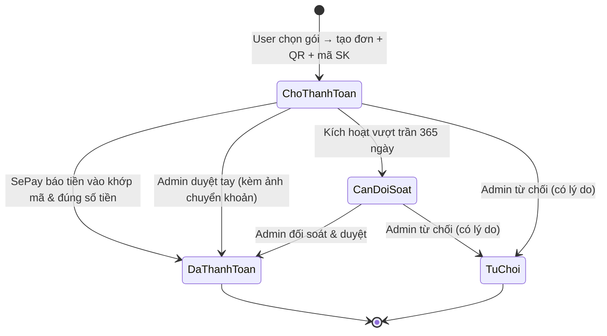

# Nghiệp vụ Premium Membership & Thanh toán SePay

- **Cập nhật:** 2026-11-13
- **Trạng thái:** Đã triển khai xong phần hệ thống (backend, dữ liệu, đối soát, kiểm thử). Chưa làm giao diện web/mobile.
- **Đối tượng đọc:** Thành viên dự án (Product, UI/UX, Frontend, QA, Vận hành).
- **Tài liệu kỹ thuật liên quan:** `docs/sepay-setup.md` (hướng dẫn cấu hình SePay khi đưa lên server).

---

## 1. Tổng quan & Phạm vi

Chức năng này cho phép Sử Ký bán gói thành viên trả phí để mở khoá các series và tập podcast Premium, thanh toán bằng chuyển khoản ngân hàng qua mã QR và tự động kích hoạt nhờ SePay.

| Trong phạm vi | Ngoài phạm vi (không làm đợt này) |
|---|---|
| 3 gói: Free, Tháng, Năm | Ví điện tử / số dư tài khoản |
| Thanh toán chuyển khoản QR từng đơn | Tự động gia hạn (auto-renew) |
| Tự kích hoạt qua SePay + admin duyệt tay | Hoàn tiền tự động trong hệ thống |
| Khoá/mở khoá nội dung theo nhãn Premium | Xuất hoá đơn điện tử / trang điều khoản |
| Cấp gói miễn phí, thu hồi quyền, báo cáo doanh thu | Gửi email / thông báo đẩy nhắc hết hạn |
| Nhắc sắp hết hạn bằng banner trong app | Tải nghe offline, gói bỏ quảng cáo, xem trước |

---

## 2. Gói thành viên & Quyền lợi

### 2.1. Các gói `(10.1)`

| Gói | Giá niêm yết | Thời hạn | Có thể mua | Ghi chú |
|---|---:|---:|---|---|
| **Free** | 0đ | Không giới hạn | Không | Trạng thái mặc định của người dùng chưa mua gói. |
| **Gói tháng** | 20.000đ | 30 ngày | Có | Mua trực tiếp hoặc cộng dồn. |
| **Gói năm** | 220.000đ | 365 ngày | Có | Tiết kiệm hơn 12 tháng lẻ. Nếu giao diện hiện "giảm từ 240.000đ" thì chỉ là nhãn hiển thị, không lưu giá gốc. |

### 2.2. Quyền lợi theo gói

| Tính năng | Free | Premium (Tháng / Năm) |
|---|---|---|
| Nghe series và tập thường | Có | Có |
| Nghe tập Premium lẻ | Không | Có |
| Nghe toàn bộ tập trong Series Premium | Không | Có |
| Đọc kịch bản (lời thoại) của tập Premium | Không | Có |
| Playlist, lưu tiến độ nghe, Quiz, XP, Nhiệm vụ, Bảng xếp hạng, Triển lãm | Có | Có |

### 2.3. Cộng dồn thời hạn & hết hạn

- **Cộng dồn:** Nếu đang còn hạn Premium mà mua thêm, thời hạn mới được cộng nối tiếp vào ngày hết hạn hiện tại (không bị mất số ngày cũ).
- **Trần cộng dồn 365 ngày:** Tổng thời hạn kể từ thời điểm hiện tại không vượt quá 365 ngày.
- **Khi hết hạn:** Quyền nghe nội dung Premium bị khoá ở lần phát tiếp theo. Toàn bộ playlist, tiến độ nghe, XP của người dùng vẫn được giữ nguyên.
- **Nhắc hết hạn:** Hệ thống tính sẵn số ngày còn lại (`daysLeft`) để giao diện chủ động hiện banner nhắc (gợi ý khi còn từ 3 ngày trở xuống; ngưỡng hiển thị do phía giao diện tự quy định) `(10.1)`.

---

## 3. Nội dung Premium (khoá & mở khoá)

- **Cách gắn nhãn:** Có thể đánh dấu Premium ở cấp **Series** hoặc từng **Tập** `(10.4)`.
  - Series đánh dấu Premium ⇒ toàn bộ tập bên trong tự động bị khoá theo.
  - Series thường nhưng một tập đánh dấu Premium ⇒ chỉ riêng tập đó bị khoá.
  - Mặc định mọi nội dung cũ và mới đều là **Free**.
- **Ai được bật/tắt:** Admin và Moderator đều có quyền bật/tắt khi tạo/sửa Series hoặc sửa Tập `(10.4)`. Mọi thay đổi có hiệu lực ngay và được ghi nhận lịch sử (ai sửa, lúc nào, từ trạng thái nào sang trạng thái nào).
- **Trải nghiệm người nghe chưa mua gói:**
  - Vẫn nhìn thấy Series/Tập Premium trong danh sách, tìm kiếm, bảng xếp hạng (có dấu hiệu nhận biết đang khoá) `(10.4)`.
  - Không phát được audio và không xem được phần kịch bản chi tiết; hệ thống báo cần nâng cấp Premium `(10.4)`.
- **Ngoại lệ kiểm duyệt:** Admin và Moderator được phát audio Premium mà không cần mua gói để phục vụ kiểm duyệt nội dung.
- **Đang nghe dở thì hết hạn:** Khi server đã cấu hình khoá bảo mật ký link audio của Cloudinary (`CLOUDINARY_AUTH_TOKEN_KEY`), đường dẫn phát audio Premium sẽ có thời hạn ngắn (mặc định 1 giờ); nếu chưa cấu hình khoá này, link tạm thời không tự hết hạn. Khi có thời hạn, nếu người dùng đang nghe dở mà gói vừa hết hạn, họ vẫn nghe hết phiên hiện tại và chỉ bị chặn khi bấm phát tập mới hoặc tải lại link mới.

---

## 4. Quy trình mua gói & Thanh toán

### Luồng chuẩn

1. **Tạo đơn:** Người dùng chọn Gói tháng hoặc Gói năm. Hệ thống tạo đơn ở trạng thái **Chờ thanh toán**, sinh một mã chuyển khoản riêng dạng `SK` + 8 ký tự và tạo sẵn mã VietQR điền sẵn số tiền + nội dung chuyển khoản `(10.2)`.
2. **Chuyển khoản:** Người dùng quét QR hoặc chuyển khoản đúng số tiền và đúng mã `SK...`.
3. **Tự động kích hoạt:** Ngân hàng nhận tiền → SePay gửi thông báo về hệ thống `(10.5)` → Hệ thống khớp mã và số tiền → Đơn chuyển sang **Đã thanh toán** và cộng ngày Premium ngay cho người dùng.
4. **Cập nhật trên màn hình:** Khi đang mở trang QR, giao diện tự hỏi lại trạng thái đơn mỗi 3–5 giây cho tới khi đơn thành công hoặc cần đối soát `(10.2)`, sau đó gọi lại kiểm tra quyền hiện tại `(10.1)`.
5. **Kênh dự phòng (duyệt tay):** Nếu hệ thống ngân hàng/SePay chậm hoặc gặp sự cố, người dùng có thể tải lên ảnh chụp màn hình chuyển khoản `(10.3)` để Admin kiểm tra và duyệt kích hoạt thủ công `(10.7)`.

### Quy tắc khi tạo đơn

- **Bấm tạo đơn nhiều lần / cùng một gói:** Hệ thống trả lại đúng đơn đang chờ hiện tại, không sinh nhiều mã chuyển khoản gây nhầm.
- **Đổi sang gói khác khi đơn cũ chưa thanh toán:** Đơn chờ cũ tự động bị đóng (từ chối với lý do đổi gói/giá) để mở đơn mới.
- **Đang có đơn cần đối soát:** Hệ thống ưu tiên giữ và trả lại đơn đó để giải quyết dứt điểm với Admin trước khi tạo đơn mới.
- **Đơn chờ không tự hết hạn:** Đơn chưa chuyển tiền sẽ giữ ở trạng thái chờ cho đến khi được thanh toán hoặc Admin từ chối.

---

## 5. Xử lý các tình huống ngoại lệ

| Tình huống | Hệ thống xử lý thế nào |
|---|---|
| **Chuyển sai số tiền (thiếu hoặc thừa)** | Tiền vẫn được ghi nhận vào sổ giao dịch ở trạng thái **Cần đối soát**. Đơn **không** tự kích hoạt, không tự cộng ngày, không tự hoàn tiền. Admin kiểm tra và xử lý với người dùng. |
| **Chuyển khoản thiếu hoặc sai mã `SK...`** | Giao dịch vào sổ ở trạng thái **Chưa khớp**. Admin tìm đúng đơn để gán thủ công (nếu đúng số tiền) hoặc đánh dấu bỏ qua sau khi xử lý ngoài. |
| **Chuyển nhầm 2 lần cho cùng một đơn** | Lần đầu kích hoạt đơn. Lần thứ hai bị đưa vào **Cần đối soát** (đơn đã thanh toán trước đó), không cộng thêm kỳ hạn, không tự hoàn tiền. |
| **Admin duyệt tay trước, sau đó SePay mới báo về** | Hệ thống nhận ra đơn đã được kích hoạt, chỉ gắn mã giao dịch ngân hàng vào đơn để khớp sổ, **không** cộng trùng thêm một lần hạn nữa. |
| **SePay gửi trùng thông báo nhiều lần** | Hệ thống chống trùng theo mã giao dịch của nhà cung cấp: chỉ xử lý đúng một lần, các lần gửi lại được bỏ qua an toàn. |
| **Gói vừa hết chỗ cộng dồn (vượt 365 ngày) lúc tiền về** | Đơn chuyển sang **Cần đối soát** để Admin xử lý (không làm kẹt tiền hay mất dấu giao dịch). |
| **Admin đổi giá gói trong lúc có đơn đang chờ** | Đơn cũ vẫn giữ nguyên mức giá và số ngày đã chốt lúc tạo. Khi người dùng tạo đơn mới ở mức giá mới, đơn cũ bị đóng tự động. |
| **Giao dịch tiền ra khỏi tài khoản** | Hệ thống ghi nhận và tự động bỏ qua vì chỉ phục vụ thu tiền mua gói. |

---

## 6. Nghiệp vụ vận hành của Admin

- **Quản lý gói:** Bật/tắt bán gói, đổi tên, giá, số ngày, thứ tự hiển thị `(10.6)`. Không được bật bán gói có giá hoặc số ngày bằng 0. Việc đổi giá không làm thay đổi số liệu các đơn đã mua trước đó.
- **Duyệt đơn thủ công:** Xem danh sách đơn (lọc theo trạng thái, tìm theo email/tên/mã chuyển khoản), xem ảnh minh chứng người dùng gửi lên, bấm **Duyệt** hoặc **Từ chối** (bắt buộc nhập lý do) `(10.7)`.
- **Xử lý sổ giao dịch ngân hàng:** Xem toàn bộ tiền vào từ cổng thanh toán, lọc theo cổng/trạng thái/ngày. Với các khoản chưa khớp hoặc lệch, Admin có thể **Gán vào đơn** (yêu cầu đúng số tiền) hoặc **Bỏ qua** kèm ghi chú `(10.8)`.
- **Quản lý thành viên & đặc quyền (`10.9`):**
  - Xem danh sách người dùng đang còn hạn hoặc đã hết hạn.
  - **Cấp gói miễn phí (Comp):** Tặng gói tháng/năm (giá 0đ, không tính vào doanh thu) cho cộng tác viên, đối tác hoặc bù lỗi, bắt buộc nhập lý do.
  - **Thu hồi quyền (Revoke):** Tước quyền Premium ngay lập tức (kèm lý do) nếu phát hiện gian lận hoặc huỷ giao dịch.
- **Báo cáo doanh thu & vận hành (`10.10`):**
  - Xem tổng doanh thu, số đơn đã thu tiền, số lượt cấp miễn phí, doanh thu tách theo ngày/tháng và theo từng gói (tính theo giờ Việt Nam).
  - Theo dõi các chỉ số vận hành: số thành viên đang hoạt động, số người sắp hết hạn trong 7 ngày tới, số đơn chờ quá 24 giờ, số đơn cần đối soát, số tiền giao dịch chưa khớp.

---

## 7. Các quyết định nghiệp vụ & Lý do

| Quyết định | Lý do | Hệ quả cần biết |
|---|---|---|
| **Chuyển khoản trực tiếp theo đơn, không làm ví/số dư** | Giảm độ phức tạp tài chính, không phải giữ tiền hộ người dùng, phù hợp quy mô dự án nhóm. | Không có tính năng nạp tiền trước hay tự động gia hạn. |
| **Tự động qua SePay + dự phòng duyệt tay** | Đảm bảo trải nghiệm mua nhanh, nhưng vẫn bán được hàng khi ngân hàng/SePay trục trặc. | Cần giữ luồng upload ảnh minh chứng và màn hình duyệt cho Admin. |
| **Không hoàn tiền tự động trong hệ thống** | Hoàn tiền tự động đòi hỏi kết nối chi hộ và đối soát phức tạp, rủi ro cao. | Khi cần hoàn tiền, Admin chuyển khoản ngoài và ghi chú lại; báo cáo doanh thu không tự trừ khoản này. |
| **Ghi nhận vĩnh viễn, không xoá dữ liệu tiền (append-only)** | Phục vụ đối soát, kiểm tra chéo khi có tranh chấp. | Không cho phép xoá user nếu user đó đã từng phát sinh đơn mua hoặc kỳ hạn. |
| **Chốt bản sao (snapshot) giá và tên gói trên từng đơn** | Đổi giá gói trong tương lai không làm sai lệch doanh thu và lịch sử mua cũ. | Cần xử lý đóng đơn chờ cũ khi giá gói thay đổi. |
| **Trần cộng dồn tối đa 365 ngày** | Kiểm soát cam kết dịch vụ, tránh người dùng mua dồn nhiều năm với giá cũ. | Người dùng đang còn bất kỳ thời hạn Premium nào (kể cả còn vài phút) sẽ **không mua được Gói năm (365 ngày)** vì tổng vượt 365 ngày; chỉ mua lại Gói năm sau khi hạn cũ đã hết (có thể nới trần bằng cấu hình nếu leader muốn). |
| **Lệch tiền đưa vào Cần đối soát thay vì tự cộng ngày theo tỉ lệ** | Tránh kích hoạt sai gói hoặc phát sinh sai số lẻ khó kiểm soát. | Admin phải xử lý tay các ca chuyển nhầm tiền. |
| **Vẫn cho người dùng Free thấy series/tập Premium trong danh sách** | Giữ khả năng khám phá nội dung và tạo động lực nâng cấp gói. | Chỉ chặn lúc bấm phát audio và ẩn nội dung kịch bản. |
| **Tách lớp cổng thanh toán (hiện tại là SePay)** | Để sau này có thể gắn thêm cổng khác (như payOS…) mà không phải sửa lại quy trình đơn hàng, kích hoạt hay báo cáo. | Hiện tại mới vận hành thực tế với SePay. |
| **Cập nhật kết quả bằng hỏi lại định kỳ (polling)** | Giao dịch ngân hàng chỉ xảy ra vài phút một lần, không cần duy trì kết nối thời gian thực tốn tài nguyên. | Màn hình QR cần tự gọi kiểm tra mỗi 3–5 giây và dừng khi có kết quả. |

---

## 8. Những gì đã triển khai & Bước tiếp theo

### Đã hoàn thành (Backend)

- Thiết kế và cập nhật cơ sở dữ liệu cho gói, đơn hàng, kỳ hạn, sổ giao dịch đa cổng thanh toán và nhãn Premium cho Series/Tập.
- Toàn bộ luồng nghiệp vụ cho người dùng: xem gói, kiểm tra quyền hiện tại, tạo đơn/QR, gửi ảnh chuyển khoản, xem lịch sử đơn.
- Luồng nhận thông báo thanh toán từ SePay: xác thực bảo mật, chống trùng, tự động kích hoạt, tự phục hồi khi gọi lại.
- Toàn bộ nghiệp vụ cho Admin: quản lý gói, duyệt/từ chối đơn, xử lý sổ giao dịch, cấp/thu hồi gói, báo cáo doanh thu.
- Chặn phát audio và ẩn kịch bản với nội dung Premium; hỗ trợ cấp đường dẫn audio có thời hạn cho người dùng Premium (khi bật khoá ký link).
- Ghi nhận lịch sử thay đổi (audit) cho toàn bộ thao tác tiền và thay đổi nhãn Premium.
- Viết tài liệu hướng dẫn cấu hình SePay, tài liệu API (OpenAPI + Changelog cho Frontend) và kiểm thử tự động các luồng chính.

### Còn lại (để chạy thật)

1. **Làm giao diện Web / Mobile:** Trang mua gói, màn hình QR + polling, upload ảnh minh chứng, giao diện khoá/banner sắp hết hạn, trang quản trị cho Admin.
2. **Điền thông tin nhận tiền thật:** Điền số tài khoản, tên chủ tài khoản, mã xác thực webhook vào cấu hình server và khai báo webhook trên trang quản trị SePay.
3. **Cấu hình & kiểm tra thực tế audio có thời hạn:** Điền khoá ký link audio (`CLOUDINARY_AUTH_TOKEN_KEY`) lên server và chạy thử trên file audio thật khi ghép giao diện để chắc chắn trình phát nhạc hoạt động ổn định với link có hạn.
4. **Quyết định của Leader (nếu cần):** Có giữ trần cộng dồn 365 ngày (chặn mua nối gói năm sớm) hay nới lên 730 ngày.

---

## 9. Thuật ngữ nhanh

- **Kỳ hạn (Membership):** Khoảng thời gian (30 ngày hoặc 365 ngày) người dùng có quyền nghe nội dung Premium.
- **Webhook:** Cơ chế SePay tự động báo tin cho hệ thống ngay khi tài khoản ngân hàng nhận được tiền chuyển khoản.
- **Đối soát:** Việc Admin kiểm tra chéo giữa đơn mua hàng, ảnh chụp chuyển khoản và tiền thực tế vào tài khoản ngân hàng.
- **Snapshot:** Lưu chết thông tin tên gói, giá tiền tại đúng thời điểm người dùng bấm mua để sau này đổi giá cũng không ảnh hưởng đơn cũ.
- **Idempotent (chống trùng):** Dù thao tác bị bấm 2 lần hoặc SePay gửi thông báo lặp lại nhiều lần, hệ thống chỉ ghi nhận và cộng quyền đúng 1 lần.

---

## 10. Danh sách API & Cách dùng (tham chiếu)

Mục này giải thích ngắn gọn **muốn làm việc gì thì gọi API nào, truyền gì vào**. Chi tiết kiểu dữ liệu đầy đủ xem tại `/docs` (tag `Membership`) và `apps/api/CHANGELOG.md`.

### 10.1. Xem gói & kiểm tra quyền hiện tại (Người dùng)
- **`GET /api/membership/plans`** *(không cần đăng nhập)*: Lấy danh sách gói đang bật (gồm cả gói Free `isPurchasable: false`) để vẽ bảng so sánh gói.
- **`GET /api/me/membership`** *(cần đăng nhập)*: Nguồn chuẩn để biết user đang là `free` hay `premium`, ngày hết hạn (`expiresAt`), số ngày còn lại (`daysLeft`), mã gói (`planCode`) và đơn đang chờ gần nhất (`pendingOrderId`). Giao diện dùng API này để quyết định hiện nút mua, banner nhắc hạn hay mở khoá.

### 10.2. Tạo đơn, xem QR, theo dõi trạng thái & lịch sử (Người dùng)
- **`POST /api/me/membership/orders`** *(cần đăng nhập)*: Tạo đơn mua gói.
  - **Truyền vào:** Header `Idempotency-Key` (chuỗi UUID v4 ngẫu nhiên mỗi lần bấm mua) + Body `{ "planCode": "monthly" | "yearly" }`.
  - **Trả về:** Thông tin đơn + khối `bank` (tên ngân hàng, số tài khoản, tên chủ TK, link ảnh `qrUrl`, số tiền `amount`, nội dung chuyển khoản `transferContent` dạng `SK...`).
- **`GET /api/me/membership/orders/:id`** *(cần đăng nhập)*: Lấy chi tiết & trạng thái 1 đơn. Khi đang mở màn hình QR, giao diện gọi lại API này mỗi 3–5 giây cho đến khi `status` là `paid`, `needs_review` hoặc `rejected`.
- **`GET /api/me/membership/orders`** *(cần đăng nhập)*: Xem lịch sử các đơn đã tạo (hỗ trợ `?page=1&limit=20`).

### 10.3. Upload & xác nhận ảnh minh chứng chuyển khoản (Người dùng)
Quy trình gồm 2 bước API với hệ thống + 1 bước đẩy file lên Cloudinary (chỉ áp dụng khi đơn đang `pending` hoặc `needs_review`):
1. **Xin phiếu upload:** Gọi **`POST /api/me/membership/orders/:id/proof-ticket`**
   - **Truyền vào:** `{ "kind": "IMAGE", "fileName": "...", "sizeBytes": 12345, "mimeType": "image/jpeg" }`.
   - **Trả về:** `assetId` và thông tin upload (`upload.url`, `upload.fields`).
2. **Đẩy ảnh lên Cloudinary:** Giao diện gửi file ảnh trực tiếp tới `upload.url` kèm các field trong `upload.fields` → Cloudinary trả về `public_id`.
3. **Xác nhận gắn ảnh vào đơn:** Gọi **`POST /api/me/membership/orders/:id/proof`**
   - **Truyền vào:** `{ "assetId": "<assetId bước 1>", "publicId": "<public_id từ Cloudinary>" }`.
   - **Kết quả:** Server kiểm tra ảnh hợp lệ rồi gắn vào đơn (`proofUploaded: true`). Nếu gửi lại lần nữa, ảnh mới sẽ thay ảnh cũ.

### 10.4. Gắn nhãn Premium & kiểm soát phát nội dung (Studio + Người nghe)
- **Gắn nhãn ở Studio (Admin / Moderator):**
  - Khi tạo mới Series: **`POST /api/studio/series`** — truyền thêm `"isPremium": true` (hoặc `false`) trong body.
  - Khi sửa Series đã có: **`PATCH /api/studio/series/:id`** — truyền `{ "isPremium": true | false }`.
  - Khi sửa Tập đã có: **`PATCH /api/studio/episodes/:id`** — truyền `{ "isPremium": true | false }`. *(Lưu ý: API tạo mới tập `POST` chưa nhận cờ này, cần tạo tập xong rồi sửa nếu muốn bật Premium lẻ.)*
- **Hiển thị danh sách & chi tiết (Người nghe):**
  - **`GET /api/series`**, **`GET /api/series/:slug`**, **`GET /api/episodes/:slug`**: Trả thêm `isPremium` và `locked` (`true` nếu nội dung cần Premium mà user chưa có gói) để giao diện hiện icon ổ khoá / nút nâng cấp. Khi `locked: true`, nội dung `scriptContent` bị ẩn thành `null`.
- **Phát audio & lưu tiến độ (Người nghe):**
  - **`GET /api/narrations/:narrationId/playback`**: Lấy link phát audio. Nếu bị khoá, trả lỗi `403 PREMIUM_REQUIRED`. Nếu hợp lệ, trả link audio (có thời hạn ngắn nếu server đã bật `CLOUDINARY_AUTH_TOKEN_KEY` — giao diện không nên cache link lâu, cứ mỗi lần phát thì gọi lại).
  - **`PUT /api/me/listening-progress/:narrationId`**: Đồng bộ giây đang nghe; cũng trả `403 PREMIUM_REQUIRED` nếu tập/series bị khoá.
  - *(Admin và Moderator tự động được phát và lưu tiến độ không cần mua gói.)*

### 10.5. Nhận thông báo thanh toán từ SePay (Hệ thống)
- **`POST /api/payments/:provider/webhook`** (với SePay là **`POST /api/payments/sepay/webhook`**): SePay tự gọi khi tài khoản nhận được tiền, kèm header `Authorization: Apikey <SEPAY_WEBHOOK_API_KEY>`. Frontend và người dùng không gọi API này.

### 10.6. Admin: Quản lý gói thành viên
- **`GET /api/admin/membership/plans`**: Lấy toàn bộ gói, kể cả gói đang tắt (`isActive: false`).
- **`PATCH /api/admin/membership/plans/:code`** (`code` là `free`, `monthly`, `yearly`): Sửa tên (`name`), giá (`priceVnd`), số ngày (`durationDays`), cho phép mua (`isPurchasable`), hiển thị (`isActive`), thứ tự (`sortOrder`).

### 10.7. Admin: Xem & duyệt/từ chối đơn
- **`GET /api/admin/membership/orders`**: Lọc đơn toàn hệ thống theo `?status=pending|needs_review|paid|rejected` hoặc tìm kiếm `?q=<email/tên/mã SK>`.
- **`GET /api/admin/membership/orders/:id`**: Xem chi tiết đơn, link ảnh minh chứng (`proofUrl`), nút có được duyệt hay không (`canApprove`) và các giao dịch ngân hàng liên quan.
- **`POST /api/admin/membership/orders/:id/verify`**: Duyệt hoặc từ chối đơn đang mở.
  - Duyệt: `{ "action": "approve" }` (kích hoạt gói ngay).
  - Từ chối: `{ "action": "reject", "reason": "Lý do từ chối (10–500 ký tự)" }`.

### 10.8. Admin: Đối soát sổ giao dịch ngân hàng
- **`GET /api/admin/membership/transactions`**: Xem tiền vào từ cổng thanh toán, lọc theo `?provider=sepay`, `?status=unmatched|needs_review|matched|ignored`, `?from=YYYY-MM-DD`, `?to=YYYY-MM-DD`.
- **`POST /api/admin/membership/transactions/:id/resolve`**: Xử lý giao dịch chưa khớp hoặc lệch:
  - Gán vào đơn (chỉ được khi số tiền khớp giá đơn): `{ "action": "assign", "orderId": "<id đơn>", "note": "ghi chú tuỳ chọn" }`.
  - Đánh dấu bỏ qua (sau khi xử lý ngoài): `{ "action": "ignore", "note": "ghi chú tuỳ chọn" }`.

### 10.9. Admin: Quản lý thành viên (xem, cấp miễn phí, thu hồi)
- **`GET /api/admin/membership/members`**: Xem danh sách thành viên theo `?status=active|expired|all` và tìm `?q=...`.
- **`POST /api/admin/membership/members/:userId/grant`**: Cấp gói miễn phí (Comp).
  - **Truyền vào:** Header `Idempotency-Key` (UUID v4) + Body `{ "planCode": "monthly" | "yearly", "reason": "Lý do cấp (3–500 ký tự)" }`.
- **`POST /api/admin/membership/members/:userId/revoke`**: Thu hồi mọi kỳ hạn đang hoạt động của user.
  - **Truyền vào:** Body `{ "reason": "Lý do thu hồi (10–500 ký tự)" }`.

### 10.10. Admin: Báo cáo doanh thu & vận hành
- **`GET /api/admin/membership/report`**: Lấy số liệu tổng quan (`summary`) và biểu đồ doanh thu (`series`) theo gói.
  - **Truyền vào (query):** `from=YYYY-MM-DD`, `to=YYYY-MM-DD` (tối đa 366 ngày, tính trọn ngày theo giờ VN), `groupBy=day|month`.
