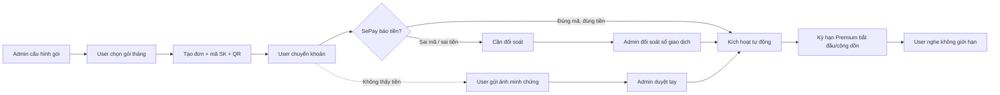
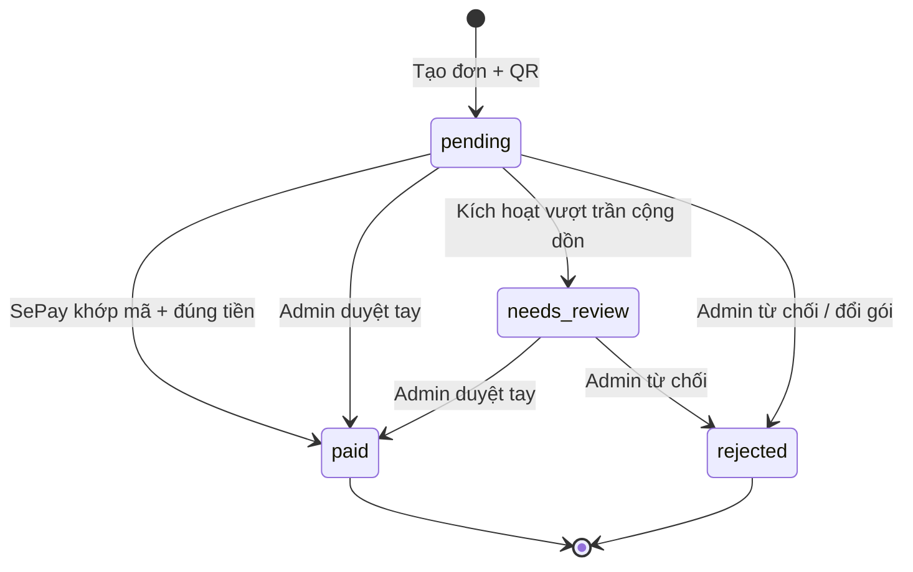
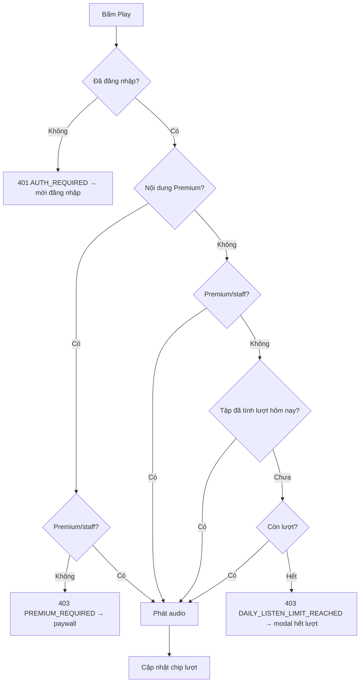

# Premium v2 — Đặc tả nghiệp vụ đầy đủ cho Mock Frontend

- **Ngày viết:** 2026-11-17
- **Trạng thái:** Backend đã xong, có test. Frontend **chưa làm** — tài liệu này để mock trước.
- **Đối tượng đọc:** UI/UX, Frontend (web/mobile), QA. Người đọc **không cần biết gì** về hệ thống trước đó.
- **Tài liệu tham chiếu:** `apps/api/CHANGELOG.md` (hợp đồng API chi tiết), `docs/premium-membership-business.md` (bản nghiệp vụ cũ, phần thanh toán vẫn đúng), `docs/sepay-setup.md` (cấu hình SePay).

> Cách đọc: mục 1–9 là nghiệp vụ và luồng; mục 10 là vận hành Admin; mục 11 là đặc tả màn hình để mock; mục 12 là JSON mẫu; mục 13–15 là dữ liệu giả, checklist và câu hỏi mở.

---

## 1. Ai là ai

| Actor | Mô tả | Liên quan Premium |
|---|---|---|
| **Khách** (chưa đăng nhập) | Xem danh sách/chi tiết tự do | **Không phát được audio**; bấm play bị mời đăng nhập |
| **Free** | Tài khoản đã đăng nhập, chưa mua gói | Nghe tối đa N tập/ngày (mặc định 4); không nghe nội dung Premium |
| **Premium** | Có kỳ hạn gói tháng còn hiệu lực | Nghe không giới hạn, kể cả nội dung Premium |
| **Moderator** | Nhân sự sản xuất nội dung | Nghe không giới hạn để kiểm duyệt; **không** được gắn nhãn Premium |
| **Admin** | Quản trị hệ thống, doanh thu | Nghe không giới hạn; **là người duy nhất** gắn nhãn Premium và quản lý gói/thành viên |

---

## 2. Gói thành viên & quyền lợi

### 2.1. Danh sách gói

| Gói | `code` | Giá | Thời hạn | Đang bán | Ghi chú |
|---|---|---:|---:|---|---|
| Miễn phí | `free` | 0đ | — | Không | Trạng thái mặc định, dùng để vẽ bảng so sánh |
| Gói tháng | `monthly` | 20.000đ | 30 ngày | **Có** | Gói duy nhất mua được |
| Gói năm | `yearly` | 220.000đ | 365 ngày | Không | Đã tắt trong dữ liệu (`is_active=false`); giữ lại để tra cứu đơn cũ |

- API công khai **không trả gói năm**.
- **Không có API tạo gói mới.** Ba gói trên do dữ liệu hệ thống tạo sẵn. Admin chỉ **sửa** gói qua `PATCH /api/admin/membership/plans/:code` — vì vậy mock chỉ cần màn "danh sách gói + sửa", **không cần form tạo gói**.
- Admin **có thể** bật lại gói năm bằng `isActive: true`, nhưng luồng bán mặc định chỉ dành cho gói tháng. Không thiết kế UI mua gói năm.

### 2.2. Quyền lợi

| Tính năng | Khách | Free | Premium | Admin/Moderator |
|---|---|---|---|---|
| Xem danh sách/chi tiết series, tập | Có | Có | Có | Có |
| Phát audio | Không | Có, tối đa N tập/ngày | Không giới hạn | Không giới hạn |
| Nghe lại cùng tập trong ngày | — | Không tính thêm lượt | Không giới hạn | Không giới hạn |
| Nghe tập/series Premium | Không | Không | Có (khi còn hạn) | Có |
| Đọc kịch bản tập Premium trên API công khai | Không | Không | Có | **Không** — staff chỉ đọc trong Studio |
| Playlist, tiến độ, quiz, XP, nhiệm vụ, xếp hạng, triển lãm | Không | Có | Có | Có |
| Gắn nhãn Premium | Không | Không | Không | Chỉ Admin |

### 2.3. Giới hạn lượt nghe miễn phí

- Chỉ áp dụng cho tài khoản **Free đã đăng nhập**; cấu hình `premium.free_daily_plays` (1–50, mặc định 4), bật/tắt bằng `premium.enforce_daily_quota`.
- Một "lượt" = **một tập bắt đầu phát thành công trong ngày**, tính theo **ngày Việt Nam (UTC+7), reset 00:00**.
- Khoá theo **tập**:
  - Đổi bản kể (third/first person) của cùng tập: không tính thêm.
  - Nghe lại tập đã tính hôm nay: miễn phí, kể cả khi đã hết lượt.
  - Tập đã nghe hôm trước không bị khoá; hôm sau nghe lại tính 1 lượt mới.
- Hết lượt: vẫn xem danh sách/chi tiết; chỉ chặn khi **phát tập mới chưa tính hôm nay**.
- Premium và staff không bị giới hạn và API trả `quota = null`.
- Khi admin tắt giới hạn: `quota.enforced = false`, `limit = null`, `remaining = null` → UI ẩn mọi thứ đếm lượt.

---

## 3. Toàn cảnh luồng



---

## 4. Luồng 1 — Admin cấu hình gói

Ai: **Admin**. Màn: Quản lý gói thành viên.

1. `GET /api/admin/membership/plans` → trả **toàn bộ** gói, kể cả gói đang tắt, có `isActive`.
2. Sửa một gói: `PATCH /api/admin/membership/plans/:code` (`free` | `monthly` | `yearly`).

Body nhận: `name`, `priceVnd`, `durationDays`, `isPurchasable`, `isActive`, `sortOrder` — gửi trường nào sửa trường đó, ít nhất 1 trường.

Quy tắc:
- Không thể bật bán (`isPurchasable: true`) gói có giá ≤ 0 hoặc số ngày ≤ 0 → `422 PLAN_NOT_PURCHASABLE`.
- Đổi giá/số ngày **không** làm thay đổi các đơn đã tạo: mỗi đơn giữ snapshot giá + tên + số ngày tại lúc tạo.
- Nếu admin đổi giá/ngày khi user đang có đơn chờ **cùng gói**: lần user bấm mua tiếp theo, đơn cũ bị **từ chối tự động** với `rejectionReason: "PLAN_PRICE_CHANGED"` và đơn mới được tạo.
- Mọi thay đổi ghi audit `membership.plan.update`.

Hiển thị UI:
- Bảng gói: tên, giá, số ngày, thứ tự, "Đang bán", "Đang hiển thị". Không có nút xoá/tạo.
- Gói năm hiện ở trạng thái tắt nếu admin cần thấy dữ liệu cũ; không có nút mua.

---

## 5. Luồng 2 — User mua gói tháng

Ai: **User đã đăng nhập** (Free hoặc Premium). Màn: Chọn gói → QR → chờ kết quả.

### 5.1. Bước 1 — Xem gói

- `GET /api/membership/plans` (công khai) trả mảng gói đang hiển thị, gồm `free` (`isPurchasable: false`) và `monthly`.
- UI: bảng so sánh 2 gói + nút **Mua gói tháng**. Nếu đang Premium, nút đổi thành **Gia hạn**.

### 5.2. Bước 2 — Tạo đơn

`POST /api/me/membership/orders` (cần đăng nhập)

- Header bắt buộc: `Idempotency-Key: <UUID v4>` — sinh mới cho **mỗi lần bấm mua**; giữ nguyên key khi retry cùng request.
- Body: `{ "planCode": "monthly" }`.
- Trả `201` + header `Location`, body là order kèm khối `bank`:

```json
{
  "id": "0b9a...",
  "planCode": "monthly",
  "planName": "Gói tháng",
  "priceVnd": 20000,
  "durationDays": 30,
  "transferContent": "SK1A2B3C4D",
  "status": "pending",
  "reviewReason": null,
  "createdAt": "2026-11-17T10:00:00.000Z",
  "paidAt": null,
  "expiresAt": "2026-12-17T10:00:00.000Z",
  "rejectionReason": null,
  "proofUploaded": false,
  "bank": {
    "bankName": "BIDV",
    "accountNumber": "1234567890",
    "accountName": "SU KY",
    "qrUrl": "https://img.vietqr.io/image/...",
    "amount": 20000,
    "transferContent": "SK1A2B3C4D"
  }
}
```

Quy tắc trả về:

| Tình huống | Kết quả |
|---|---|
| Bấm mua lại **cùng gói, cùng giá, cùng số ngày** khi đơn cũ còn `pending` | Trả lại **đúng đơn cũ**, không sinh mã mới |
| Đang có đơn `needs_review` | Luôn trả lại đơn đó, bất kể chọn gói nào; phải xử lý dứt điểm |
| Chọn gói có **giá hoặc số ngày khác** khi đang có đơn `pending` | Đơn cũ chuyển `rejected` (`PLAN_PRICE_CHANGED`), tạo đơn mới. (Hiện chỉ bán gói tháng nên thực tế chỉ xảy ra khi admin đổi giá/số ngày giữa chừng.) |
| Thiếu/sai header `Idempotency-Key` | `400 IDEMPOTENCY_KEY_REQUIRED` |
| Dùng lại key nhưng body khác | `422 IDEMPOTENCY_KEY_REUSED` |
| Key đang được xử lý | `409 IDEMPOTENCY_REQUEST_IN_PROGRESS` |
| Tổng thời hạn vượt trần 365 ngày | `422 STACK_LIMIT_REACHED`, message có ngày tối đa mua được |
| Gói không tồn tại | `404 PLAN_NOT_FOUND` |
| Gói không mở bán (free, hoặc đã tắt) | `422 PLAN_NOT_PURCHASABLE` |

- `expiresAt` của đơn đang mở = **hạn dự kiến sau khi thanh toán** (cộng dồn vào hạn hiện tại nếu còn). Đơn `rejected` trả `null`.
- Đơn `pending` **không tự hết hạn**; chỉ bị từ chối khi đổi gói hoặc admin từ chối.

### 5.3. Bước 3 — Thanh toán

- QR trong `bank.qrUrl` đã điền sẵn số tiền + nội dung `SK...`.
- User phải chuyển **đúng số tiền** (`bank.amount`) và **đúng nội dung** (`bank.transferContent`).
- Màn QR cần: số tiền lớn, nội dung + nút copy, ảnh QR, tên/số tài khoản, cảnh báo "chuyển đúng nội dung SK...".

### 5.4. Bước 4 — Theo dõi kết quả

- Poll `GET /api/me/membership/orders/:id` mỗi **3–5 giây** khi màn QR đang mở.
- Dừng khi `status` là `paid`, `needs_review` hoặc `rejected`; sau đó gọi lại `GET /api/me/membership` để cập nhật quyền.
- Trạng thái đơn:

| `status` | Nghĩa | UI |
|---|---|---|
| `pending` | Chờ thanh toán / chờ duyệt | Tiếp tục hiện QR + polling |
| `paid` | Đã kích hoạt | Màn thành công + hạn mới |
| `needs_review` | Cần admin đối soát (`reviewReason`) | "Đã nhận thông tin, đang kiểm tra" + lý do ngắn |
| `rejected` | Bị từ chối (`rejectionReason`) | Thông báo lý do + nút tạo đơn mới |

`reviewReason` trên order hiện **chỉ** có một giá trị: `STACK_LIMIT_REACHED` (vượt trần cộng dồn). Sai tiền, chuyển lần 2, tiền về sau khi từ chối… **không** đổi trạng thái order — chúng là `reason` của **giao dịch ngân hàng** trong sổ đối soát (Admin xem ở mục 10.2). Khi đó order vẫn `pending` (hoặc `paid` nếu đã kích hoạt trước đó) và Admin xử lý ở sổ giao dịch, không phải ở màn duyệt đơn.

### 5.5. Bước 5 — Kênh dự phòng: gửi ảnh minh chứng

Chỉ dùng khi đơn `pending` hoặc `needs_review`. Gồm 3 lời gọi:

1. **Xin phiếu upload** — `POST /api/me/membership/orders/:id/proof-ticket`
   Body: `{ "kind": "IMAGE", "fileName": "bill.jpg", "sizeBytes": 123456, "mimeType": "image/jpeg" }`.
   Trả: `{ assetId, upload: { url, fields }, expiresAt }`.
   Giới hạn ảnh: `image/jpeg`, `image/png`, `image/webp`, tối đa **5 MB**; phiếu có hạn ~50 phút.
2. **Đẩy file lên Cloudinary** — POST form-data tới `upload.url` kèm đúng `upload.fields`; nhận `public_id`.
3. **Gắn vào đơn** — `POST /api/me/membership/orders/:id/proof` body `{ "assetId": "...", "publicId": "..." }`.
   Server kiểm tra ảnh tồn tại; gửi lại sẽ **thay ảnh cũ**. Kết quả trả lại order với `proofUploaded: true`.

Lỗi: ảnh sai định dạng `422 MEDIA_TYPE_NOT_ALLOWED`, quá dung lượng `422 MEDIA_TOO_LARGE`, chưa upload xong `409 MEDIA_NOT_UPLOADED`.

---

## 6. Luồng 3 — Kích hoạt & cộng dồn kỳ hạn

### 6.1. Hai con đường kích hoạt



1. **Tự động (chuẩn):** User chuyển khoản → SePay gọi webhook `POST /api/payments/sepay/webhook` → hệ thống tìm đơn theo mã `SK...` → nếu **đúng số tiền** và đơn còn mở → kích hoạt ngay, ghi audit `membership.activated`. FE không gọi webhook.
2. **Admin duyệt tay:** `POST /api/admin/membership/orders/:id/verify` với `{ "action": "approve" }` (dùng khi SePay chậm hoặc user đã gửi ảnh minh chứng).

Cả hai đều đi qua cùng một logic kích hoạt, nên không thể cộng trùng.

Lưu ý quan trọng: **sai số tiền không làm đơn đổi trạng thái.** Khi SePay báo tiền về nhưng lệch giá, hệ thống ghi giao dịch vào sổ ở trạng thái `needs_review` (`AMOUNT_MISMATCH`) và **đơn vẫn `pending`**; Admin xử lý ở màn Sổ giao dịch, không ở màn Duyệt đơn. Tương tự với chuyển lần 2 (`ORDER_ALREADY_PAID`) và tiền về sau khi đơn bị từ chối (`ORDER_REJECTED`).

### 6.2. Cách tính kỳ hạn

- Lấy hạn xa nhất của user (mọi kỳ hạn chưa thu hồi).
- Nếu hạn đó **còn trong tương lai**: kỳ mới bắt đầu từ hạn đó → cộng dồn.
- Nếu đã hết hạn hoặc chưa từng có: bắt đầu từ **bây giờ**.
- Trần cộng dồn: `premium.max_stack_days` (mặc định **365 ngày kể từ hôm nay**). Vượt trần → đơn chuyển `needs_review` (`STACK_LIMIT_REACHED`), không tự kích hoạt.

### 6.3. Sau khi kích hoạt

- Tạo bản ghi kỳ hạn; user thành `tier: "premium"`.
- Hiệu lực ngay với mọi API (playback, kịch bản, `locked`).
- Đơn `paid` hiển thị trong lịch sử; `expiresAt` trả hạn thực của kỳ hạn.
- Audit: `membership.order.verify` (admin), `membership.activated` (webhook).

---

## 7. Luồng 4 — Hết hạn & gia hạn

- `GET /api/me/membership` trả:
  - `tier`: `free` | `premium`
  - `expiresAt`, `daysLeft` (Premium; `daysLeft` làm tròn lên, tối thiểu 1)
  - `planCode`, `pendingOrderId`
  - `renewSoon`: `true` khi `daysLeft <= 5`
  - `quota`: object với Free, `null` với Premium/staff
- Hết hạn: nội dung Premium bị khoá ở lần phát kế tiếp; playlist/tiến độ/XP giữ nguyên; user rơi về Free và **quota theo ngày áp dụng lại**.
- Gia hạn: luồng mua y hệt, chỉ khác CTA. Đơn đang chờ được ưu tiên hiển thị qua `pendingOrderId`.
- Banner `renewSoon`: ngôn ngữ "Gói Premium còn N ngày" + CTA Gia hạn.

---

## 8. Luồng 5 — Nghe podcast (quota + khoá Premium)

### 8.1. Quyết định khi bấm Play



### 8.2. API phát audio

`GET /api/narrations/:narrationId/playback` — **bắt buộc đăng nhập**.

Trả:

```json
{
  "narrationId": "...",
  "episodeId": "...",
  "audio": { "assetId": "...", "url": "https://...", "mimeType": "audio/mpeg", "durationMs": 900000 },
  "progress": null,
  "sync": { "intervalMs": 15000, "completionThreshold": 0.9 }
}
```

- URL audio **luôn có thời hạn** (mặc định 1 giờ khi server bật ký link Cloudinary): không cache, không lưu local, mỗi lần phát gọi lại.
- `progress` khác `null` khi đã có tiến độ; dùng để tua đúng chỗ.
- `sync.intervalMs` là chu kỳ gọi `PUT /api/me/listening-progress/:narrationId`.

Đồng bộ tiến độ:

- `GET /api/me/listening-progress/:narrationId` — lấy tiến độ đã lưu.
- `PUT /api/me/listening-progress/:narrationId` — body `{ "assetId": "...", "positionMs": 12345, "playedBitmap": "<base64>", "sessionId": "...", "sessionPlayedBitmap": "..." }` (`sessionId` và `sessionPlayedBitmap` phải gửi cùng nhau).
- Không kiểm tra quota ở API tiến độ (không trả audio), chỉ kiểm tra khoá Premium.

### 8.3. Hiển thị khoá

- `GET /api/series`, `/api/series/:slug`, `/api/episodes/:slug` trả `isPremium` + `locked`.
- `locked` chỉ xét membership → **admin/moderator vẫn có thể thấy `locked = true`** ở API public; đồng thời `scriptContent` trả `null` cho cả staff. Staff phát audio Premium được, nhưng đọc kịch bản phải vào Studio.
- UI người nghe: badge Premium trên card, khối khoá thay player, ẩn kịch bản. UI staff: không dùng `locked` để quyết định quyền, dùng role.

---

## 9. Luồng 6 — Gắn nhãn Premium (Studio)

- Nhãn đặt ở **Series** hoặc **Tập**:
  - Series Premium ⇒ toàn bộ tập bên trong khoá theo.
  - Series thường + 1 tập Premium ⇒ chỉ tập đó khoá.
  - Mặc định mọi nội dung là Free.
- **Chỉ Admin**:
  - Tạo Series: `POST /api/studio/series` với `"isPremium": true`.
  - Sửa Series: `PATCH /api/studio/series/:id` với `"isPremium": true|false`.
  - Sửa Tập: `PATCH /api/studio/episodes/:id` với `"isPremium": true|false`.
  - **Tạo tập `POST /api/studio/episodes` không nhận `isPremium`** — phải tạo rồi sửa.
- Moderator gửi thay đổi nhãn → `403 PREMIUM_ADMIN_ONLY`. UI phải disable toggle với Moderator, kèm tooltip "Chỉ Admin được đặt nhãn Premium".
- Đổi nhãn Tập ghi audit `episode.premium_changed` (ai, lúc nào, từ giá trị nào sang giá trị nào, IP). Series ghi `series.updated`.
- Hiệu lực ngay: lần phát kế tiếp đã bị khoá/mở.

---

## 10. Luồng 7 — Admin vận hành

### 10.1. Duyệt / từ chối đơn

- `GET /api/admin/membership/orders?status=pending|needs_review|paid|rejected&q=<email/tên/mã SK>&page&limit`
- `GET /api/admin/membership/orders/:id` → order + `proofUrl`, `canApprove`, `transactions[]`.
- `POST /api/admin/membership/orders/:id/verify`:
  - Duyệt: `{ "action": "approve", "note": "..." }` (note tuỳ chọn).
  - Từ chối: `{ "action": "reject", "reason": "10–500 ký tự", "note": "..." }`.

Order admin có thêm: `user { id, name, email }`, `proofUrl`, `proofUploaded`, `canApprove`, `rejectionReason`, `bankTransactionId`, `adminNote`.

### 10.2. Đối soát sổ giao dịch ngân hàng

- `GET /api/admin/membership/transactions?provider=sepay&status=unmatched|needs_review|matched|ignored&from=YYYY-MM-DD&to=YYYY-MM-DD`
  - `from`/`to` là ngày Việt Nam; `to` tính trọn ngày.
- `POST /api/admin/membership/transactions/:id/resolve`:
  - Gán vào đơn: `{ "action": "assign", "orderId": "...", "note": "..." }` — **chỉ khi số tiền giao dịch khớp giá đơn**.
  - Bỏ qua: `{ "action": "ignore", "note": "..." }`.

Giao dịch trả: `provider`, `externalId`, `amount`, `content`, `code`, `transactionAt`, `status`, `reason`, `order` (nếu đã gắn).

`reason` thường gặp: `NO_MATCHING_ORDER`, `AMOUNT_MISMATCH`, `ORDER_ALREADY_PAID`, `ORDER_REJECTED`, `ORDER_NEEDS_REVIEW`, `STACK_LIMIT_REACHED`, `OUTBOUND`, `MANUAL_IGNORE`.

### 10.3. Thành viên: cấp & thu hồi

- `GET /api/admin/membership/members?status=active|expired|all&q=<email/tên>&page&limit`
  - Mỗi dòng: `userId`, `name`, `email`, `planCode`, `planName`, `startsAt`, `expiresAt`, `revokedAt`. Một user một dòng (kỳ hạn xa nhất).
- `POST /api/admin/membership/members/:userId/grant`
  - Header `Idempotency-Key` (UUID v4) bắt buộc.
  - Body: `{ "planCode": "monthly", "reason": "3–500 ký tự" }`. **Chỉ nhận `monthly`**; gửi `yearly` → `422 VALIDATION_ERROR`.
  - Tạo đơn comp giá 0 + kích hoạt ngay; trả `{ orderId, membershipId, userId, expiresAt }`.
- `POST /api/admin/membership/members/:userId/revoke`
  - Body `{ "reason": "10–500 ký tự" }`.
  - Thu hồi **mọi kỳ hạn còn hiệu lực**, trả `{ userId, revoked }`; không có kỳ hạn hiệu lực → `404 NOT_FOUND`.

### 10.4. Báo cáo

`GET /api/admin/membership/report?from=YYYY-MM-DD&to=YYYY-MM-DD&groupBy=day|month`

- `from`/`to` là ngày Việt Nam, `to` tính trọn ngày; tối đa 366 ngày.
- Trả:

```json
{
  "range": { "from": "...", "to": "...", "groupBy": "day" },
  "summary": {
    "revenueVnd": 400000,
    "paidOrders": 20,
    "compGrants": 3,
    "activeMembers": 18,
    "expiringIn7Days": 4,
    "pendingOver24h": 1,
    "needsReviewOrders": 2,
    "unmatchedTransactions": 3,
    "unmatchedAmountVnd": 60000
  },
  "series": [
    { "bucket": "2026-11-17", "revenueVnd": 40000, "paidOrders": 2,
      "byPlan": [{ "planCode": "monthly", "revenueVnd": 40000, "paidOrders": 2 }] }
  ]
}
```

### 10.5. Cấu hình

Admin sửa qua `PATCH /api/admin/configs/:key` body `{ "value": ... }`; xem danh sách qua `GET /api/admin/configs`.

| Key | Kiểu | Mặc định | Ý nghĩa |
|---|---|---:|---|
| `premium.free_daily_plays` | int 1–50 | 4 | Số tập Free được nghe mỗi ngày |
| `premium.enforce_daily_quota` | boolean | true | Bật/tắt giới hạn lượt |
| `premium.max_stack_days` | int > 0 | 365 | Trần cộng dồn kỳ hạn |
| `media.audio_delivery_ttl_seconds` | int > 0 | 3600 | Hạn của URL audio |

---

## 11. Đặc tả màn hình để mock

### 11.1. Người dùng

| Màn | Trạng thái cần mock | Nguồn dữ liệu |
|---|---|---|
| **Home / danh sách series** | badge Premium, card bị khoá, chip lượt (Free) | `/api/series`, `/api/me/membership` |
| **Chi tiết tập — Free** | play bình thường, chip "Còn 2/4 lượt" | `/api/episodes/:slug`, playback |
| **Chi tiết tập — Premium** | khối khoá thay player, kịch bản ẩn, CTA nâng cấp | `/api/episodes/:slug` (`locked`) |
| **Chưa đăng nhập** | bấm play → modal "Đăng nhập để nghe podcast" | 401 |
| **Hết lượt** | modal "Bạn đã dùng hết N lượt hôm nay", mốc reset, CTA nâng cấp | 403 `DAILY_LISTEN_LIMIT_REACHED` |
| **Trang thành viên — Free** | thẻ Free, quyền lợi, khối lượt hôm nay, nút Nâng cấp | `/api/me/membership` |
| **Trang thành viên — Premium** | hạn dùng, số ngày còn lại, nút Gia hạn, lịch sử đơn | idem |
| **Premium sắp hết hạn** | banner vàng `renewSoon` + CTA | idem |
| **Chọn gói** | so sánh Free/Tháng, giá 20.000đ, nút Mua | `/api/membership/plans` |
| **QR chờ thanh toán** | QR, số tiền, nội dung SK, polling (đơn không có hạn) | order detail |
| **Kết quả** | thành công / cần đối soát / bị từ chối | order detail |
| **Gửi ảnh minh chứng** | chọn ảnh, upload, trạng thái đã gửi, gửi lại | proof-ticket / proof |
| **Lịch sử đơn** | danh sách + trạng thái + lý do | `/api/me/membership/orders` |

Copy gợi ý:
- Hết lượt: "Bạn đã dùng hết 4 lượt nghe miễn phí hôm nay. Lượt mới mở lúc 00:00."
- Paywall: "Tập này thuộc gói Premium. Nâng cấp để nghe toàn bộ series và không giới hạn lượt."
- Đăng nhập: "Đăng nhập để nghe podcast và lưu tiến độ."

### 11.2. Admin

| Màn | Thành phần |
|---|---|
| Quản lý gói | bảng gói + modal sửa (tên, giá, số ngày, bật bán, hiển thị, thứ tự); cảnh báo khi bật bán gói giá 0 |
| Duyệt đơn | bảng lọc trạng thái + tìm kiếm; chi tiết có ảnh minh chứng, nút Duyệt/Từ chối (lý do bắt buộc) |
| Sổ giao dịch | bảng lọc provider/trạng thái/ngày; hành động Gán đơn/Bỏ qua kèm ghi chú |
| Thành viên | bảng active/expired; modal Cấp gói (chỉ tháng + lý do) và Thu hồi (lý do) |
| Báo cáo | thẻ summary + biểu đồ doanh thu theo ngày/tháng + tách theo gói |
| Cấu hình | 2 key quota + trần cộng dồn |
| Studio | toggle Premium trên Series/Tập; disabled với Moderator |

---

## 12. Hợp đồng dữ liệu chi tiết

### 12.1. `GET /api/me/membership`

Free:

```json
{
  "tier": "free",
  "expiresAt": null,
  "daysLeft": null,
  "planCode": null,
  "pendingOrderId": null,
  "renewSoon": false,
  "quota": {
    "enforced": true,
    "limit": 4,
    "usedToday": 2,
    "remaining": 2,
    "resetsAt": "2026-11-17T17:00:00.000Z"
  }
}
```

Premium:

```json
{
  "tier": "premium",
  "expiresAt": "2026-11-20T10:00:00.000Z",
  "daysLeft": 3,
  "planCode": "monthly",
  "pendingOrderId": null,
  "renewSoon": true,
  "quota": null
}
```

- `resetsAt` là **instant UTC** của 00:00 giờ Việt Nam. Ví dụ trên = 00:00 ngày 18/11 giờ VN. Format theo timezone máy user, đừng cộng/trừ 7 giờ thủ công.
- `quota.enforced = false` → `limit` và `remaining` là `null`.

### 12.2. `GET /api/membership/plans` (công khai)

```json
[
  { "code": "free",    "name": "Miễn phí",  "priceVnd": 0,     "durationDays": 0,  "isPurchasable": false, "sortOrder": 0 },
  { "code": "monthly", "name": "Gói tháng", "priceVnd": 20000, "durationDays": 30, "isPurchasable": true,  "sortOrder": 1 }
]
```

### 12.3. Danh sách đơn (user)

`GET /api/me/membership/orders?page=1&limit=20` → `{ "items": [Order], "total": 3 }` (mỗi item cùng shape với order ở mục 5.2).

### 12.4. Phiếu upload minh chứng

```json
{
  "assetId": "c1f0...",
  "upload": { "url": "https://api.cloudinary.com/v1_1/.../image/upload", "fields": { "api_key": "...", "timestamp": "...", "signature": "...", "public_id": "..." } },
  "expiresAt": "2026-11-17T11:00:00.000Z"
}
```

### 12.5. Lỗi chuẩn

Body: `{ "error_code": "...", "message": "...", "details": [...] }`. `message` đã là tiếng Việt ở các lỗi nghiệp vụ chính; mock dùng nguyên văn được.

| HTTP | `error_code` | Khi nào |
|---|---|---|
| 400 | `IDEMPOTENCY_KEY_REQUIRED` | Thiếu/sai `Idempotency-Key` |
| 401 | `AUTH_REQUIRED` | Chưa đăng nhập ở API cần auth |
| 403 | `PREMIUM_REQUIRED` | Nội dung Premium, chưa có gói |
| 403 | `DAILY_LISTEN_LIMIT_REACHED` | Free hết lượt hôm nay |
| 403 | `PREMIUM_ADMIN_ONLY` | Moderator đổi nhãn Premium |
| 404 | `PLAN_NOT_FOUND` | Mã gói không tồn tại |
| 404 | `MEMBERSHIP_ORDER_NOT_FOUND` | Đơn không tồn tại / không thuộc user |
| 404 | `NOT_FOUND` | User/giao dịch không tồn tại |
| 409 | `ORDER_NOT_PENDING` | Đơn/giao dịch đã xử lý xong |
| 409 | `IDEMPOTENCY_REQUEST_IN_PROGRESS` | Key đang được xử lý |
| 422 | `PLAN_NOT_PURCHASABLE` | Gói không mở bán, giá/ngày ≤ 0 |
| 422 | `STACK_LIMIT_REACHED` | Tổng hạn vượt trần 365 ngày |
| 422 | `IDEMPOTENCY_KEY_REUSED` | Key dùng cho request khác |
| 422 | `VALIDATION_ERROR` | Body/số tiền không hợp lệ |
| 422 | `MEDIA_TYPE_NOT_ALLOWED` / `MEDIA_TOO_LARGE` | Ảnh minh chứng sai loại/quá lớn |
| 409 | `MEDIA_NOT_UPLOADED` | Chưa đẩy file lên Cloudinary |
| 404 | `PAYMENT_PROVIDER_UNSUPPORTED` | Webhook sai provider |

---

## 13. Bộ dữ liệu mẫu để mock

| Tài khoản | `/me/membership` | Dùng để mock |
|---|---|---|
| `free_con_luot` | `free`, `usedToday=2`, `remaining=2`, `limit=4` | chip lượt, play bình thường |
| `free_het_luot` | `free`, `usedToday=4`, `remaining=0` | modal hết lượt |
| `free_quota_tat` | `free`, `enforced=false`, `limit=null` | UI ẩn chip |
| `premium_sap_het` | `premium`, `daysLeft=3`, `renewSoon=true` | banner gia hạn |
| `premium` | `premium`, `daysLeft=25` | trạng thái thường |
| `admin` / `moderator` | `free`, `quota=null` | Studio toggle |

Nội dung mẫu: 1 series Free (5 tập), 1 series Premium (3 tập), 1 series Free có 1 tập Premium lẻ.

---

## 14. Checklist nghiệm thu mock

- [ ] Khách bấm play → modal đăng nhập, không phải màn lỗi; sau đăng nhập phát tiếp đúng tập.
- [ ] Free còn lượt → phát được, chip giảm 1 khi nghe tập mới; nghe lại cùng tập không giảm.
- [ ] Free hết lượt → modal có mốc reset + CTA; nghe lại tập cũ vẫn phát.
- [ ] Premium hết hạn → nội dung Premium khoá lại, nội dung Free vẫn theo quota.
- [ ] `renewSoon` → banner gia hạn đúng 5 ngày cuối.
- [ ] Nội dung Premium: badge ở list, khối khoá thay player, kịch bản ẩn.
- [ ] Không còn UI gói năm hoặc toggle tháng/năm.
- [ ] Mua gói: thiếu `Idempotency-Key` không xảy ra (FE luôn sinh); bấm 2 lần chỉ 1 đơn.
- [ ] QR đúng số tiền + nội dung SK; polling dừng đúng trạng thái.
- [ ] Upload minh chứng đúng 2 bước API + 1 bước Cloudinary; thay ảnh được.
- [ ] Admin duyệt/từ chối có lý do; sổ giao dịch gán đơn chỉ khi khớp tiền.
- [ ] Cấp gói chỉ chọn tháng; thu hồi có lý do; báo cáo lọc ngày VN đúng.
- [ ] Studio: Admin bật/tắt nhãn; Moderator thấy disabled và không có request đổi nhãn.

---

## 15. Câu hỏi mở (chốt khi review mock)

1. Chip lượt: header web / trong player sheet mobile?
2. Banner `renewSoon`: chỉ trang thành viên hay cả home/player? (đề xuất: cả hai, tối đa 1 banner)
3. Hiển thị lượt dạng số ("Còn 2/4") hay thanh tiến trình?
4. Sau khi `needs_review`, hiển thị lý do kỹ thuật hay câu thân thiện?
5. Có cần màn so sánh Free/Premium riêng hay gộp vào trang thành viên?

**Ngoài phạm vi:** quảng cáo chèn giữa, tải offline, tự động gia hạn, ví/số dư, mã giảm giá, hoàn tiền trong app, email/push nhắc hạn, gói năm.
