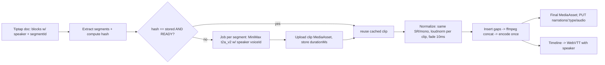

# Research Report: Two-Narrator Alternating Mode (TTS podcast pipeline)

Date: 2026-10-22. Scope: design only, no code in repo. Budget: 5 tool calls (1 skill read + 4 web searches). Only search-result snippets were read, not full pages. Anything beyond a snippet = [UNVERIFIED] or [INFERENCE].

## Executive Summary

Primary constraint: MiniMax t2a_v2 takes one `voice_id` per request ([MiniMax sync T2A](https://platform.minimax.io/docs/api-reference/speech-t2a-http); body not fully read, `timber_weights` seen in [HopBase mirror](https://hop-base.com/en/docs/api-reference/t2a-v2)). So the pipeline must be **segment-level synthesis**: one request per speaker turn, then ffmpeg concat. No native multi-speaker call exists in MiniMax [UNVERIFIED: no multi-speaker mode seen in snippets].

Vendors that do native dialogue (ElevenLabs Text to Dialogue, Google MultiSpeakerMarkup / Gemini-TTS) are structured as **ordered turns, each = {speaker/voice, text}** in JSON. That is the same shape as our segment model, so we get a vendor-portable abstraction for free. Recommended: store turns as segments in DB, derive them from Tiptap via a **per-paragraph `speaker` attribute**, hash each segment, synthesize only changed ones, concat at the end.

Recommendation: **Option B** (Tiptap block attribute `speaker` + `NarrationSegment` table, per-segment hash cache, ffmpeg concat with fixed gap). Single-narrator mode = same pipeline with all segments speaker A (one code path).

## Research Methodology
- Sources: 12 URLs surfaced via search (snippets only). Dates: 2026 docs.
- Terms: ElevenLabs Text to Dialogue, request stitching previous_text/next_text, Google MultiSpeakerMarkup, MiniMax t2a_v2 voice_id.
- Not searched (budget): NotebookLM internals, OpenAI TTS, Descript, ffmpeg loudnorm docs, Vietnamese voice catalog, AI-voice-of-deceased legal. These sections rely on [INFERENCE]/prior knowledge and are flagged.

## Key Findings

### 1. How vendors structure two-host scripts
| Vendor | Structure | Source |
|---|---|---|
| ElevenLabs Text to Dialogue | `inputs: [{text, voice_id}, ...]` ordered turns; v3/v4 accept `[audio tags]` in text; keep total text ≤ ~2,000 chars per request for reliability | [overview](https://elevenlabs.io/docs/overview/capabilities/text-to-dialogue), [quickstart](https://elevenlabs.io/docs/eleven-api/guides/cookbooks/text-to-dialogue) |
| Google Cloud TTS | `MultiSpeakerMarkup` = collection of `Turn` (speaker alias + text); Gemini-TTS takes turn-level style direction | [MultiSpeakerMarkup](https://docs.cloud.google.com/text-to-speech/docs/reference/rest/Shared.Types/MultiSpeakerMarkup), [Gemini-TTS](https://docs.cloud.google.com/text-to-speech/docs/gemini-tts), [Gemini API TTS](https://ai.google.dev/gemini-api/docs/generate-content/speech-generation) |
| MiniMax | one voice per call; sync HTTP or WebSocket sentence-by-sentence | [HTTP](https://platform.minimax.io/docs/api-reference/speech-t2a-http), [WS](https://platform.minimax.io/docs/api-reference/speech-t2a-websocket) |
| NotebookLM Audio Overviews / OpenAI / Descript | not researched. [INFERENCE] NotebookLM generates a dialogue script then TTS per host; Descript edits by transcript with speaker labels. Treat as unverified. | n/a |

Common denominator: **ordered list of {speaker, text}**. Markup formats ranking for us:
1. JSON segments (internal, canonical). Lossless, typed, zod-able.
2. `Speaker A: text` lines: only as an import/export or AI-prompt format (LLM-friendly). Ambiguous with colons in Vietnamese prose; parse only at boundary.
3. SSML `<voice>`: skip. MiniMax does not take SSML as far as seen [UNVERIFIED]; adds a parser for nothing.

### 2. Tiptap as source of truth
| Approach | Pros | Cons |
|---|---|---|
| A. `speaker` attr on paragraph block (global attribute extension) | One block = one turn; trivial to map to segments; UI = colored left border/label; survives copy/paste; JSON stays Tiptap-native | Mid-paragraph speaker change impossible (force split — which is what you want for TTS anyway) |
| B. Inline mark `speaker` | Allows mid-paragraph switches | Segmentation must walk marks, merge adjacent runs; fragile edits; no benefit as TTS call is per-turn |
| C. Separate lines `A: ...` as plain text | No schema change | Parsing, collision with content, loses rich text; AI edits can corrupt |

Choose A. Adjacent blocks with same speaker may merge into one segment (fewer calls, better prosody) OR stay split per paragraph — config decision (see Open Questions). Quoted historical figure inside narrator text = inline quote kept in speaker A's block, not a switch, unless mod explicitly assigns B.

### 3. Segment synthesis + assembly
- One MiniMax call per segment. Pin identical `audio_setting` (sample_rate, format, bitrate, channel) across all segments → concat without re-encode drift. [INFERENCE] MiniMax supports sample_rate/format params (seen in `audio_setting` per docs; not verified in snippet).
- Assemble with ffmpeg: decode all to same PCM (e.g. 44.1k/mono), insert silence gaps, `concat` demuxer/filter, then encode once to MP3. Avoid concatenating MP3 frames directly (encoder padding clicks) [INFERENCE: common ffmpeg knowledge].
- Loudness: per-segment `loudnorm` (EBU R128) or measure-and-gain per voice so speaker A/B levels match; final pass loudnorm to −16 LUFS (podcast norm, [INFERENCE]). Simplest: normalize each segment to the same target before concat; skip final pass.
- Gap: default 250–400 ms same-speaker, 350–600 ms on speaker change [INFERENCE: tune by ear]; configurable per segment (`pauseAfterMs`). Crossfade 0 by default: crossfade only hides clicks, which fade-in/out 5–10 ms handles. Overlap/interruption = out of scope (needs multitrack mix; ElevenLabs dialogue doesn't promise it either [UNVERIFIED]).
- Intra-segment pauses: MiniMax pause markup `<#x#>` [UNVERIFIED: only from memory/search term, not seen in snippets] — verify in docs before depending on it.

### 4. Prosody across turn boundaries
- ElevenLabs offers `previous_text`/`next_text` and `previous_request_ids` for stitching; if both text and request IDs sent, `previous_text` is ignored ([stitching doc](https://elevenlabs.io/docs/eleven-api/guides/how-to/text-to-speech/request-stitching), [js issue #64](https://github.com/elevenlabs/elevenlabs-js/issues/64)). Context text is not billed [per third-party experiment page, weak source](https://elevenlabs.providers.sgit.ai/experiments/text-handling/index.html).
- MiniMax: no equivalent seen [UNVERIFIED]. Practical consequence: each turn starts "cold". Mitigations: (a) keep segments paragraph-sized, not sentence-sized; (b) merge consecutive same-speaker paragraphs; (c) fixed voice_setting (speed/vol/pitch/emotion) per speaker; (d) fixed gaps masking intonation reset; (e) avoid `emotion` flips per segment unless mod sets them. If MiniMax lacks context hints, accept it: alternating voices hide cold starts well, since a new voice = expected reset.

### 5. Regenerate one segment (hash/cache/idempotency)
- `hash = sha256(normalizedText + voiceId + modelId + voiceSettingJSON + audioSettingJSON + pronunciationDictVersion)`. If hash == stored `audioHash` and status READY → skip.
- Edit one paragraph → only that segment's hash changes → one MiniMax call + re-assemble (ffmpeg on cached segment files, cheap).
- Idempotent job key: `(narrationId, segmentIndexId, hash)`. Retry safe; stale result discarded if hash no longer matches current text on completion.
- Segment identity: stable `segmentId` stored on Tiptap block attr (uuid) so reorder/insert don't invalidate neighbors. Index-based identity = bad (insert shifts everything).
- Final episode audio: derive; store `assembledHash = hash(ordered segment hashes + gap config)`.

### 6. Subtitle / timeline
- Per-segment `durationMs` (from decoded audio, not API estimate) + gap → cumulative `startMs/endMs`. Emit WebVTT/SRT with `<v Speaker>` voice tag (WebVTT supports `<v>` [INFERENCE: spec knowledge]). Sentence-level inside segment: [UNVERIFIED] whether MiniMax returns subtitles/timestamps (I recall a `subtitle_enable` param; verify). Else split by proportional character count: [INFERENCE] rough, OK for v1.

### 7. History podcast two-narrator usage + ethics
- Common formats [INFERENCE, not researched]: (1) narrator + "voice of the figure" reading primary-source quotes; (2) two hosts conversational; (3) host + expert. For Sử Ký, (1) fits a history CMS best: narrator A = storytelling, voice B = quotes/chronicle excerpts/figure.
- Disclosure: AI-voice-for-historical-figure = fabricated performance of a real person's words/likeness. Dead historic figures (centuries old) = low legal risk but credibility risk. Rules to suggest: label episode "giọng đọc AI" in description; mark B-lines as "tái hiện" when text is not a verified source quote; never clone a real living or recently deceased person's voice without written consent; use stock/designed voices only. MiniMax voice-clone terms/consent requirements [UNVERIFIED]. Vietnam AI-labeling law [UNVERIFIED, not researched].

### 8. Vietnamese specifics
- Distinguishability: choose voices with different gender, or different region (Bắc vs Nam) + different pitch. Gender difference is the strongest cue; same-gender pair needs distinct timbre/pitch/speed. [INFERENCE]
- MiniMax Vietnamese voice catalog and accent labels: [UNVERIFIED] — requires query of the `get_voice` endpoint / docs (RepoVoiceScout / MinimaxTtsResearch peers likely cover it).
- Regional accent for B voice used for historical figure is a creative choice, not a correctness one; keep configurable per voice.
- Number/date/name normalization (years, Hán-Việt names) is a pronunciation-dict concern; include dict version in hash.

## Comparative Analysis — Design Options

| Dimension | A: Plain-text `A:/B:` lines → parse on save | **B: Tiptap `speaker` block attr + `NarrationSegment` table (recommended)** | C: Use vendor-native dialogue API (ElevenLabs/Gemini) |
|---|---|---|---|
| Fits MiniMax (1 voice/call) | Yes | **Yes** | No (switches vendor) |
| Source-of-truth fidelity | Weak, parse ambiguity | **Strong, rich text kept** | Strong |
| Single-segment regen | Needs parser to give stable ids | **Yes via block uuid + hash** | Poor: one request returns whole dialogue (≤~2k chars) |
| Prosody continuity | Cold starts | Cold starts (mitigate by merge) | Best (native turn-taking) |
| Effort | Low | Medium | Medium + vendor change |
| Risk | Corrupted lines, AI edits | Schema migration of segments (new table) | Vendor lock, Vietnamese quality unknown [UNVERIFIED] |
| Single-narrator parity | Separate path | **Same path (all speaker A)** | Separate path |

Option A is a trap: cheap now, parsing bugs and no stable identity later. Option C answers a problem we don't have yet and contradicts the MiniMax choice.

## Recommended Data Model (sketch)

```
EpisodeNarration (existing)
  scriptDocument (Tiptap JSON; paragraph attrs: segmentId uuid, speaker "A"|"B")
  narrationMode: SINGLE | DUAL
  voiceAssignments: { A: voiceId, B?: voiceId }  // + per-speaker voiceSettings
  gapConfig: { sameSpeakerMs, speakerChangeMs }
  assembledHash, finalAudioAssetId -> MediaAsset (existing flow)

NarrationSegment
  id (= Tiptap block segmentId)   narrationId   orderIndex
  speaker        "A"|"B"
  text           normalized plain text of block(s)
  voiceId        snapshot at synth time
  settingsJSON   speed/vol/pitch/emotion/model, audio_setting
  hash           sha256(text+voiceId+settingsJSON+pronDictVersion)
  audioAssetId   -> MediaAsset | null       (cached clip)
  durationMs     measured from decoded audio
  pauseAfterMs   override | null
  status         PENDING | RUNNING | READY | FAILED | STALE
  error          nullable
  UNIQUE(narrationId, id)
```
Rules: save script → diff blocks → upsert segments, set STALE where hash mismatch, delete orphans. Per-segment jobs keyed `(id, hash)`.

## Pipeline Sketch



## Implementation Recommendations
1. Ship SINGLE first through the segment pipeline (all A); DUAL = add attr + second voice. No second code path.
2. Merge consecutive same-speaker paragraphs up to a char cap (config) to improve prosody and cut calls.
3. Bound parallelism of MiniMax calls (rate limits [UNVERIFIED]); retry only on 429/5xx, not 4xx.
4. Assembly on server via ffmpeg (needs ffmpeg binary in API deploy — check hosting).
5. Skip: overlap/interruptions, crossfade, inline-mark speakers, SSML, vendor-native dialogue.

### Common pitfalls
- Index-based segment ids (break caching on insert).
- Concatenating MP3 directly (clicks, wrong durations).
- Different sample rates per voice.
- Trusting API-reported duration; measure.
- Hashing without voice settings / dict version → stale audio served.

## Resources & References
- ElevenLabs Text to Dialogue: https://elevenlabs.io/docs/overview/capabilities/text-to-dialogue
- ElevenLabs quickstart: https://elevenlabs.io/docs/eleven-api/guides/cookbooks/text-to-dialogue
- ElevenLabs stitching: https://elevenlabs.io/docs/eleven-api/guides/how-to/text-to-speech/request-stitching
- Google MultiSpeakerMarkup: https://docs.cloud.google.com/text-to-speech/docs/reference/rest/Shared.Types/MultiSpeakerMarkup
- Gemini-TTS: https://docs.cloud.google.com/text-to-speech/docs/gemini-tts
- Gemini API speech generation: https://ai.google.dev/gemini-api/docs/generate-content/speech-generation
- MiniMax sync T2A: https://platform.minimax.io/docs/api-reference/speech-t2a-http ; WS: https://platform.minimax.io/docs/api-reference/speech-t2a-websocket
- HopBase T2A v2 mirror (secondary): https://hop-base.com/en/docs/api-reference/t2a-v2

## Limitations
Snippet-only reading; NotebookLM/OpenAI/Descript, ffmpeg loudnorm specifics, Vietnamese voice catalog, and legal/disclosure rules not researched (call budget). Gap/LUFS numbers are [INFERENCE] starting points to tune by ear.

## Unresolved Questions
1. Does MiniMax t2a_v2 offer context hints (prev/next text), subtitle/timestamp output, `<#x#>` pause markup? Verify in full docs.
2. MiniMax per-request char limit and rate limit → sets segment cap and concurrency.
3. Which MiniMax Vietnamese voices exist, gender/region labels, and are 2 clearly distinct ones available?
4. Merge same-speaker paragraphs into one segment, or one segment per paragraph? (regen granularity vs prosody)
5. Is ffmpeg available on the API host (or must assembly run in a worker/container)?
6. Is B voice "second host" or "quote voice"? Changes UI labels, disclosure text.
7. Disclosure policy and Vietnamese legal requirements for AI voice labeling; MiniMax clone-consent terms if cloning ever planned.
8. Should segment cache clips be stored in Cloudinary MediaAsset (cost, clutter) or temp storage with only final audio persisted?
