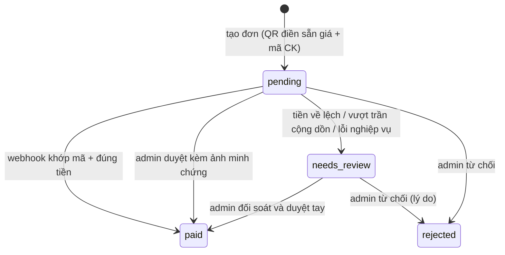

# Nghiệp vụ: Premium membership (banner in-app, trả trực tiếp)

- Cập nhật: 2026-11-12 (chốt theo phản hồi leader)
- Trạng thái: spec nghiệp vụ, chưa code
- Phạm vi: gói thành viên trả phí, khoá nội dung premium, đơn chuyển khoản qua SePay, xác nhận thủ công, báo cáo doanh thu, audit.
- Ngoài phạm vi: ví/số dư, auto-renew, hoàn tiền tự động, email/push, tải offline, quảng cáo.

## 1. Quyết định đã chốt

| # | Quyết định |
|---|---|
| 1 | 3 gói: Free (0đ), Tháng (20.000đ/30 ngày), Năm (220.000đ/365 ngày). UI hiển thị "giảm từ 240.000đ" (chỉ UI; API trả `price_vnd = 220000`) |
| 2 | Premium chỉ khoá nội dung: series premium (khoá toàn bộ tập) và episode premium (khoá lẻ từng tập). Không bán early access, offline, ads |
| 3 | Cờ premium được đặt lúc xuất bản; **admin và moderator** đều được bật/tắt, có audit |
| 4 | Trả trực tiếp bằng QR/mã CK riêng cho từng đơn; **không ví, không auto-renew** |
| 5 | Nhắc hạn: **banner in-app** tính từ `expiresAt`; không email/push |
| 6 | Không làm hoàn tiền trong hệ thống: admin xử lý ngoài, ghi chú vào đơn |
| 7 | Lệch tiền gộp vào `needs_review` (không có trạng thái `amount_mismatch` riêng) |
| 8 | Không hoá đơn điện tử; lưu tối đa dữ liệu giao dịch ngân hàng (id, thời gian, số tiền, nội dung, mã ngân hàng, raw payload) |
| 9 | Dữ liệu giao dịch giữ **vĩnh viễn**; chưa làm cron xoá, sau này làm riêng |

## 2. Gói và quyền

| | Free | Premium Tháng | Premium Năm |
|---|---|---|---|
| Giá | 0 | 20.000đ | 220.000đ |
| Thời hạn | — | 30 ngày | 365 ngày |
| Nghe series/tập thường | ✓ | ✓ | ✓ |
| Nghe episode premium | ✗ | ✓ | ✓ |
| Nghe series premium (mọi tập) | ✗ | ✓ | ✓ |
| Playlist, tiến độ, quiz, XP, nhiệm vụ, xếp hạng | ✓ | ✓ | ✓ |
| Triển lãm, xếp hạng | ✓ | ✓ | ✓ |
| Tự gia hạn | — | ✗ | ✗ |

- Free **không** phải một membership row; là trạng thái "không có kỳ hạn active". Bảng `membership_plans` vẫn có row `free` (giá 0, không mua được) để admin hiển thị/cấu hình.
- Premium có thể cộng dồn nhiều kỳ, tối đa 365 ngày kể từ hiện tại (`premium.max_stack_days`).
- Hết hạn: khoá quyền ngay ở lần phát tiếp theo; **không xoá** playlist/tiến độ. Tập đang phát dở được nghe hết vì URL audio premium có TTL (mặc định 1 giờ) — chấp nhận như hành vi hợp lệ, không cần code thêm.
- Không giới hạn mới nào cho free tier (số playlist, thiết bị…).

## 3. Khoá nội dung

- `series.is_premium` + `episode.is_premium`; hiệu lực = `series.is_premium OR episode.is_premium`.
- UI studio: toggle ở màn xuất bản/sửa series và tập; trạng thái kế thừa hiển thị rõ (series premium ⇒ mọi tập khoá, không cần bật từng tập). Mặc định `false`, tức toàn bộ nội dung hiện tại vẫn free sau khi deploy.
- Đổi cờ sau khi đã xuất bản: được phép, hiệu lực ngay, ghi audit (ai, khi nào, từ giá trị nào sang giá trị nào).
- Chốt chặn duy nhất: `GET /api/narrations/:id/playback` và episode detail. Không có membership active và nội dung premium → 403 `CONTENT_LOCKED` (`reason: PREMIUM_REQUIRED`); episode detail trả `locked: true` để UI hiện nút mở khoá. Moderator/admin bỏ qua gate.
- Nội dung premium vẫn hiện trong danh sách/tìm kiếm/xếp hạng với badge khoá; free user vẫn xem được metadata, không lấy được audio.
- URL audio premium phải có hạn: `MediaStorageGateway.deliveryUrl(asset, { ttlSeconds })` → `private_download_url` với `expires_at` (`media.audio_delivery_ttl_seconds`, default 3600). Audio free giữ URL như hiện tại. Test bắt buộc: URL premium có `expires_at`, phát được range request; URL free không đổi.
- Đã biết và chấp nhận: link audio free đã phát trước khi tập bị chuyển premium vẫn còn hiệu lực (URL ký vĩnh viễn). Muốn đóng phải rotate asset — không làm đợt này.

## 4. Đơn mua và vòng đời

Trạng thái đơn: `pending → paid | rejected | needs_review` (không có `refunded`).



Quy tắc:
1. `POST /api/me/membership/orders { planCode }` + `Idempotency-Key`: trong 1 tx khoá user row (`SELECT id FROM users WHERE id=$1 FOR UPDATE`), trả lại đơn `pending` cùng `(user_id, plan_id)` nếu có, chưa có mới tạo. Mã CK + giá snapshot tại lúc tạo.
   - Chỉ chấp nhận plan `is_purchasable = true AND is_active = true AND price_vnd > 0`; `planCode=free` hoặc plan ngừng bán ⇒ 422 `PLAN_NOT_PURCHASABLE`. Nếu không chặn, user tạo được đơn 0đ cho gói free rồi upload minh chứng để admin duyệt thành premium miễn phí.
2. Mã chuyển khoản: prefix `SK` + 8 hex, duy nhất; QR `vietqr.app` điền sẵn số tiền + nội dung.
3. Kích hoạt (webhook hoặc admin) trong 1 tx: `UPDATE membership_orders SET status='paid', paid_at=now(), bank_transaction_id=... WHERE id=$1 AND status IN ('pending','needs_review')`; `count=0` ⇒ replay, dừng. Khoá user row → `starts_at = max(now, max(expires_at))` → insert `memberships` (`order_id` UNIQUE). Vượt `premium.max_stack_days` ⇒ đơn `needs_review`, không kích hoạt.
4. Webhook 2 pha: (a) insert `sepay_transactions` (`sepay_id` UNIQUE) — sổ tiền vào, chống replay; (b) tx khớp đơn/kích hoạt.
   - Khi `sepay_id` đã tồn tại: **đọc row** — chỉ dừng (200) nếu `status IN ('matched','ignored')`; nếu row còn `unmatched|needs_review` thì chạy tiếp pha 2 (lần chạy trước chết giữa chừng hoặc lỗi hạ tầng), rồi mới trả 200. Nếu không, retry của SePay bị short-circuit và đơn kẹt `pending` dù tiền đã về.
   - Pha 2 idempotent theo trạng thái: đơn `paid` mà `bank_transaction_id IS NULL` (admin duyệt tay trước) ⇒ gán `bank_transaction_id`, đánh dấu giao dịch `matched`, không tạo kỳ hạn mới. Đơn `paid` đã có `bank_transaction_id` khác ⇒ đây là chuyển khoản thừa: giao dịch `needs_review` lý do `ORDER_ALREADY_PAID`, không kích hoạt, không hoàn tự động.
   - Không khớp mã hoặc lệch tiền ⇒ giao dịch `needs_review`/`unmatched` tương ứng; trả 200. Chỉ lỗi hạ tầng thật mới trả 500 để SePay retry.
5. Lệch tiền: không tự kích hoạt, không tự cộng. Ghi `sepay_transactions.needs_review` + `reason`, admin đối chiếu và quyết định (`resolve`). Hệ thống không tự động hoàn tiền.
6. Ảnh minh chứng: dùng khi SePay không hoạt động; user upload vào đơn `pending`; admin duyệt tay → `paid` (cùng đường kích hoạt), lý do từ chối ≥ 10 ký tự.
7. Gia hạn sớm: tạo đơn mới, cộng dồn; UI hiện ngày hết hạn dự kiến. Không auto-renew.
8. Nhắc hạn: API trả `expiresAt` + `daysLeft`; banner in-app khi `daysLeft ≤ premium.reminder_days` (default 3). Không cron, không email.
9. **Polling trạng thái thanh toán**: client gọi `GET /api/me/membership/orders/:id` mỗi 3–5 giây khi trang QR còn mở, dừng khi đơn `paid|needs_review|rejected` hoặc sau ~10 phút; khi `paid` thì gọi lại `GET /api/me/membership`. Không dùng SSE/websocket: trạng thái đổi vài phút một lần, SSE hiện chỉ có hub in-process (1 instance) cho AI check — không đáng thêm kênh realtime cho thanh toán.

## 5. Admin

- CRUD `membership_plans`: code, tên, giá, số ngày, `is_purchasable`, `is_active`, thứ tự. Không sửa giá của gói đang có đơn pending? Được — đơn giữ snapshot giá cũ.
- Duyệt/từ chối đơn (`pending|needs_review`), kèm lý do + audit.
- Sổ giao dịch ngân hàng: list `sepay_transactions` theo status/ngày/nội dung; `resolve` = `assign_to_order` (gán vào đơn rồi kích hoạt), `ignore` (đã xử lý ngoài), kèm ghi chú.
- Membership: list theo user/trạng thái; grant comp (không doanh thu, có lý do); revoke (khoá ngay, có lý do) — audit.
- Ghi chú đơn (`admin_note`) để lưu vết xử lý ngoài hệ thống (hoàn tiền, thoả thuận riêng).

**Dashboard/báo cáo** (timezone `Asia/Ho_Chi_Minh`, doanh thu tính theo `paid_at`):
- Doanh thu theo ngày/tháng trong khoảng chọn: tổng tiền, số đơn paid, breakdown theo gói (dùng snapshot tên/giá trên đơn).
- Số membership đang active (distinct user), số hết hạn trong 7 ngày tới (nguồn cho banner/CSKH), số user mua lần đầu vs gia hạn.
- Đơn `pending` quá 24h (chưa thanh toán) và đơn `needs_review` (worklist).
- Giao dịch ngân hàng chưa khớp (`unmatched|needs_review`) — số lượng + tổng tiền.
- Không tính hoàn tiền (ngoài hệ thống) — **hạn chế đã biết**: doanh thu có thể cao hơn thực nhận nếu admin hoàn tiền tay; ghi chú `admin_note` là nguồn đối chiếu duy nhất.

## 6. Dữ liệu

```
membership_plans(id uuid, code varchar unique, name, price_vnd int, duration_days int,
                 is_purchasable bool, is_active bool, sort_order int,
                 created_at, updated_at)
  -- free (0đ, không mua được), monthly (20.000đ/30d), yearly (220.000đ/365d)

membership_orders(id uuid, user_id varchar(36) FK cascade, plan_id uuid FK restrict,
                  plan_code_snapshot varchar(32), plan_name_snapshot varchar(100),
                  price_vnd int, duration_days int, currency varchar(3) default 'VND',
                  transfer_content varchar(32) unique,
                  status varchar(20) default 'pending',  -- pending|paid|needs_review|rejected
                  proof_file_url varchar(2048)?, rejection_reason text?,
                  bank_transaction_id varchar(64)?, paid_at timestamptz?,
                  verified_by varchar(36)?, verification_source varchar(10), -- auto|manual
                  admin_note text?, metadata_json jsonb?,
                  created_at, updated_at)
  index (user_id, created_at desc), (status, created_at), (paid_at)

memberships(id uuid, user_id varchar(36) FK cascade, plan_id uuid FK restrict,
            order_id uuid unique FK membership_orders,
            price_vnd int, duration_days int,
            starts_at, expires_at,
            revoked_at?, revoke_reason varchar(500)?, created_at)
  index (user_id, expires_at desc)

sepay_transactions(id uuid, sepay_id bigint unique, reference_code varchar(64),
                   amount int, accumulated bigint?, content text, code varchar(32)?,
                   gateway varchar(32), account_number varchar(32), sub_account varchar(32)?,
                   transaction_at timestamptz,
                   status varchar(20) default 'unmatched', -- unmatched|needs_review|matched|ignored
                   order_id uuid? FK membership_orders, reason varchar(100)?,
                   resolved_by varchar(36)?, resolved_at timestamptz?, note varchar(500)?,
                   raw_payload jsonb, created_at)
  index (status, created_at desc)

series.is_premium bool default false
episode.is_premium bool default false
```

Nguyên tắc dữ liệu (audit/pháp lý):
- **Append-only**: không xoá cứng đơn, kỳ hạn, giao dịch ngân hàng, audit. Sai thì đổi trạng thái + lý do.
- **Lưu vĩnh viễn** dữ liệu giao dịch/đơn/kỳ hạn (không cron purge); nếu sau này cần xoá theo thời hạn thì làm cron riêng.
- **Snapshot**: tên gói, giá, số ngày được chép vào đơn và kỳ hạn tại thời điểm mua → đổi giá sau này không viết lại lịch sử.
- **Audit log** (`writeAudit` sẵn có) cho: verify/reject đơn, resolve giao dịch, grant/revoke membership, thay đổi plan, đổi cờ premium của series/episode (admin **và** moderator). Ghi actor, IP, before/after.
- `sepay_transactions.raw_payload` lưu nguyên payload SePay (mọi trường có thể: `id`, `gateway`, `transactionDate`, `accountNumber`, `subAccount`, `code`, `content`, `transferAmount`, `accumulated`, `referenceCode`) để đối soát khi tranh chấp.
- Dữ liệu chuyển khoản chứa tên/nội dung người chuyển (PII) → chỉ admin được xem.
- `amount` là số nguyên VND, không dùng float.
- Múi giờ hiển thị/báo cáo: `Asia/Ho_Chi_Minh`; DB lưu `timestamptz`.

## 7. API

| Route | Quyền | Ghi chú |
|---|---|---|
| `GET /api/me/membership` | user | `{ tier, planCode?, expiresAt?, daysLeft?, entitlements, pendingOrderId? }` |
| `POST /api/me/membership/orders` | user + Idempotency-Key | reuse đơn pending, trả `{ orderId, amount, transferContent, bankInfo }` |
| `GET /api/me/membership/orders` | user | lịch sử đơn |
| `GET /api/me/membership/orders/:id` | user (chủ) | trạng thái + QR để hiện lại |
| `POST /api/me/membership/orders/:id/proof` | user (chủ, pending) | multipart ảnh minh chứng |
| `POST /api/payments/sepay-webhook` | API key | không session, luôn 200 sau khi xác thực key |
| `GET/POST/PATCH /api/admin/membership-plans` | admin | CRUD gói |
| `GET /api/admin/membership-orders`, `GET /:id` | admin | lọc status/ngày/plan |
| `POST /api/admin/membership-orders/:id/verify` | admin | `paid|rejected` + lý do |
| `GET /api/admin/sepay-transactions` | admin | worklist `unmatched|needs_review` |
| `POST /api/admin/sepay-transactions/:id/resolve` | admin | `assign_to_order|ignore` + note |
| `GET /api/admin/memberships` | admin | active/expired, lọc user |
| `POST /api/admin/memberships/grant`, `/:id/revoke` | admin | comp/revoke + lý do |
| `GET /api/admin/reports/dashboard` | admin | số liệu mục 5 |
| `GET /api/admin/reports/revenue?from&to&groupBy` | admin | doanh thu + breakdown |
| Studio series/episode publish | moderator/admin | thêm cờ `isPremium` vào payload xuất bản/sửa |

Mã lỗi mới: `MEMBERSHIP_REQUIRED`? Không cần — dùng `CONTENT_LOCKED`. Thêm: `MEMBERSHIP_STACK_LIMIT` (422), `PAYMENT_NOT_CONFIGURED` (503, thiếu key webhook/bank), `WEBHOOK_UNAUTHORIZED` (401), `ORDER_NOT_PENDING` (409).

## 8. Cấu hình

| Key | Default |
|---|---|
| `premium.reminder_days` | 3 |
| `premium.max_stack_days` | 365 |
| `media.audio_delivery_ttl_seconds` | 3600 |

Env: `BANK_SHORT_CODE`, `BANK_NAME`, `BANK_ACCOUNT_NUMBER`, `BANK_ACCOUNT_NAME`, `SEPAY_WEBHOOK_API_KEY` (production bắt buộc key + số tài khoản; thiếu key runtime ⇒ webhook 503).

## 9. Test bắt buộc

1. Tạo đơn 3 lần → cùng `orderId`/`transferContent`; 2 tab concurrent → 1 đơn.
2. Webhook replay cùng `sepay_id` → 1 row giao dịch, 1 kỳ hạn.
3. Webhook không khớp mã → `sepay_transactions.status='unmatched'`, đơn không đổi.
4. Webhook lệch tiền → giao dịch `needs_review`, đơn `needs_review`, không kích hoạt.
5. Vượt `max_stack_days` khi kích hoạt → đơn `needs_review`, HTTP 200, không kẹt `pending`.
6. 2 đơn paid đồng thời → 2 kỳ hạn nối tiếp, không chồng lấn (row lock user).
7. Playback premium: free → 403; premium → URL có `expires_at`; admin → 200.
8. Series premium khoá toàn bộ tập; episode premium lẻ chỉ khoá tập đó.
9. Đổi giá plan sau khi có đơn pending → đơn cũ giữ giá snapshot.
10. Báo cáo doanh thu: 2 đơn paid khác ngày, 1 đơn pending → tổng đúng, breakdown đúng gói.
11. Banner: `daysLeft` tính đúng tại ranh giới hết hạn; hết hạn → tier về free.
12. Tạo đơn với `planCode=free` (hoặc plan `is_purchasable=false`, `price_vnd=0`) → 422 `PLAN_NOT_PURCHASABLE`, không tạo đơn.
13. Webhook retry sau khi chết giữa chừng: row `sepay_transactions` đã tồn tại status `unmatched` → lần gọi lại vẫn kích hoạt đơn và đánh dấu `matched`; chỉ khi row đã `matched|ignored` mới bỏ qua.
14. Webhook đến sau khi admin đã duyệt tay: đơn `paid` chưa có `bank_transaction_id` → gán, `matched`, không tạo kỳ hạn mới; đơn `paid` đã có mã khác → giao dịch `needs_review`, không kích hoạt.

## 10. Câu hỏi còn mở

Không còn câu hỏi chặn code.

Đã chốt: giá năm 220.000đ (UI hiển thị giảm từ 240.000đ), admin + moderator bật cờ premium, không hoàn tiền, lệch tiền = `needs_review`, không hoá đơn điện tử, lưu dữ liệu vĩnh viễn, cộng dồn tối đa 365 ngày, kết quả thanh toán = polling + banner.

Bỏ hẳn phần điều khoản/`terms_version` — dự án nhóm đại học, không cần chứng minh đồng ý điều khoản.

## 11. Nguồn tham khảo

- [Entitlements pattern](https://dev.to/salable/the-entitlements-pattern-feature-gating-that-actually-works-3mjl)
- [SaaS billing UX patterns 2026](https://www.saasui.design/blog/saas-billing-subscription-ux-patterns)
- [SePay xác thực thanh toán tự động](https://sepay.vn/xac-thuc-thanh-toan.html)
- [Spotify Free vs Premium](https://www.soundguys.com/free-spotify-vs-spotify-premium-36632/)
